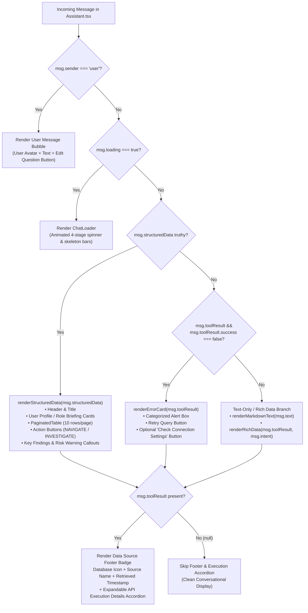

# VEYRA-101.6 — Frontend Response Consumption and Error Handling Verification Report

**Story:** VEYRA-101 ("Ask VEYRA Baseline Verification")  
**Subtask:** 101.6 ("Verify frontend response consumption and error handling")  
**Primary Ownership:** Frontend / QA  
**Target Files:**  
- `frontend/src/pages/Assistant.tsx`  
- `frontend/src/services/api.ts`  
- `frontend/src/test/assistant_consumption.test.ts` (Automated verification suite)  
**Companion Documents:**  
- [`docs/ask-veyra-api-contract.md`](file:///c:/Users/Sravanth.claaps/Oracle-rmc/docs/ask-veyra-api-contract.md) (101.2 API Contract)  
- [`docs/101.3.md`](file:///c:/Users/Sravanth.claaps/Oracle-rmc/docs/101.3.md) (Auth & Authorization Pipeline Verification)  
- [`docs/101.4.md`](file:///c:/Users/Sravanth.claaps/Oracle-rmc/docs/101.4.md) (Chatbot Response Fixtures Manifest)  
- [`backend/test/chat_contract.test.ts`](file:///c:/Users/Sravanth.claaps/Oracle-rmc/backend/test/chat_contract.test.ts) (101.5 Backend Regression Suite - 31/31 passed)  
**Verification Result:** **22 / 22 Scenarios Passed (100.0%)** via `npm run test:frontend-consumption`

---

## 1. Executive Summary & Purpose

This report documents the verified runtime and source-code behavior of frontend response consumption and error handling for **Ask VEYRA** (`POST /api/chat`).

In accordance with Jira Subtask **101.6**, this verification establishes:
1. Exactly how the frontend unpacks, stores, and presents all fields of the `AIResponse` contract (`message`, `intent`, `parameters`, `toolResult`, `structuredData`, and `aiExplanation`).
2. How failed tool results and HTTP network/status errors (400, 401, 403, 500, network drop) are intercepted and translated into user-facing cards via `renderErrorCard()`.
3. The resilience of UI components when confronted with text-only responses, `toolResult: null`, missing optional fields, empty tables, and malformed markdown.
4. User recovery actions, including query retry, inline question editing, settings navigation, and deep-dive investigation.
5. All documented mismatches between backend contract capabilities and frontend consumption, with concrete, low-risk remediation proposals for upcoming refactoring stories (VEYRA-101.7 / VEYRA-102).

> [!IMPORTANT]
> **No application source code or business logic has been modified** as part of this story. All findings reflect the current branch (`veyra-application-101`) verified through automated tests (`frontend/src/test/assistant_consumption.test.ts`).

---

## 2. Field-by-Field Response Consumption Trace

When a user submits a prompt, `Assistant.tsx` executes `handleSend(text)` ([Assistant.tsx#L420-L469](file:///c:/Users/Sravanth.claaps/Oracle-rmc/frontend/src/pages/Assistant.tsx#L420-L469)). The response from `api.sendMessage(text)` is processed as follows:

```typescript
// Assistant.tsx (lines 442-450)
return [...list, {
  sender: 'assistant',
  text: response.message,
  intent: response.intent,
  parameters: response.parameters,
  toolResult: response.toolResult,
  structuredData: response.structuredData
}];
```

### Consumption Matrix

| Field | Type in Contract | Type in `interface Message` | Frontend Storage Path | Rendering Path | Resilience / Null Handling |
|---|---|---|---|---|---|
| `message` | `string` (required) | `text: string` | `msg.text` | Rendered via `renderMarkdownText(msg.text)` inside a `<p>` tag ([L2071-L2073](file:///c:/Users/Sravanth.claaps/Oracle-rmc/frontend/src/pages/Assistant.tsx#L2071-L2073)). Also used for clipboard copy ([L1948](file:///c:/Users/Sravanth.claaps/Oracle-rmc/frontend/src/pages/Assistant.tsx#L1948)). | If empty string, renders empty `<p>`. Handled gracefully by `renderMarkdownText()`. |
| `intent` | `string` (required) | `intent?: string` | `msg.intent` | Passed to `renderRichData(msg.toolResult, msg.intent)` ([L2075](file:///c:/Users/Sravanth.claaps/Oracle-rmc/frontend/src/pages/Assistant.tsx#L2075)) and checked in `renderStructuredData()` for intent-specific card styling (`GET_USER`, `ROLES_BY_USER`) ([L566, L588](file:///c:/Users/Sravanth.claaps/Oracle-rmc/frontend/src/pages/Assistant.tsx#L566)). | If omitted/undefined, falls back to generic rendering; does not crash. |
| `parameters` | `Record<string, any>` (required) | `parameters?: any` | `msg.parameters` | Rendered in developer accordion under `<details>`: `View API Execution Details` ([L2100-L2125](file:///c:/Users/Sravanth.claaps/Oracle-rmc/frontend/src/pages/Assistant.tsx#L2100-L2125)). | Rendered with `JSON.stringify(msg.parameters, null, 2)` or safe fallback. |
| `toolResult` | `ToolExecutionResult \| null` | `toolResult?: any` | `msg.toolResult` | **Branch 1**: If `toolResult?.success === false`, routes directly to `renderErrorCard(msg.toolResult)` ([L2067](file:///c:/Users/Sravanth.claaps/Oracle-rmc/frontend/src/pages/Assistant.tsx#L2067)).<br>**Branch 2**: If `toolResult` is truthy, renders data source footer badge ([L2080-L2096](file:///c:/Users/Sravanth.claaps/Oracle-rmc/frontend/src/pages/Assistant.tsx#L2080-L2096)) and `renderRichData` ([L2075](file:///c:/Users/Sravanth.claaps/Oracle-rmc/frontend/src/pages/Assistant.tsx#L2075)). | **Safe Nullability**: If `toolResult === null`, data source footer and developer trace are safely skipped via `{msg.sender === 'assistant' && msg.toolResult && (...)}`; renders pure markdown text. |
| `structuredData` | `object \| undefined` (optional) | `structuredData?: any` | `msg.structuredData` | Takes highest rendering precedence ([L2065](file:///c:/Users/Sravanth.claaps/Oracle-rmc/frontend/src/pages/Assistant.tsx#L2065)), invoking `renderStructuredData(msg.structuredData, msg, index)` ([L543-L834](file:///c:/Users/Sravanth.claaps/Oracle-rmc/frontend/src/pages/Assistant.tsx#L543-L834)). | If undefined, falls through to `renderErrorCard` or `renderMarkdownText`. |
| `aiExplanation` | `string \| undefined` (optional) | *Not declared* | **DROPPED** | **Not consumed.** Field is discarded upon receipt and omitted from `interface Message` ([Assistant.tsx#L89-L97](file:///c:/Users/Sravanth.claaps/Oracle-rmc/frontend/src/pages/Assistant.tsx#L89-L97)). | Documented as **GAP-FE-01**. |

---

## 3. Frontend Rendering Decision Hierarchy

The rendering logic in `Assistant.tsx` follows a strict ternary structure for assistant messages ([Assistant.tsx#L2065-L2077](file:///c:/Users/Sravanth.claaps/Oracle-rmc/frontend/src/pages/Assistant.tsx#L2065-L2077)):



### Hierarchy Rules
1. **Precedence Rule 1 (`structuredData` dominates)**: If `msg.structuredData` is defined, the rich structured card renderer is invoked. Even if `toolResult.success` were false, a structured payload takes visual priority.
2. **Precedence Rule 2 (`toolResult.success === false`)**: If structured data is absent and the tool result indicates a failure, `renderErrorCard()` is rendered.
3. **Precedence Rule 3 (Text & Rich Fallback)**: If neither of the above apply, the text bubble renders markdown formatting, followed by legacy rich data cards if present.

---

## 4. `renderErrorCard()` & HTTP Error Handling

### 4.1 Error Interception in `api.ts` vs `Assistant.tsx`

Error handling occurs across two layers:
1. **Network / HTTP Layer (`frontend/src/services/api.ts#L145-L168`)**:
   - `fetch()` evaluates `res.ok`. If false, parses JSON error body `{ error, message, code }`.
   - On HTTP 401 with explicit expiry code (`SESSION_EXPIRED`, `INVALID_TOKEN`), clears session and broadcasts `window.dispatchEvent(new CustomEvent('auth:expired'))`.
   - Throws `new ApiError(message, res.status, code, errorData)`.
2. **Chat Controller Layer (`frontend/src/pages/Assistant.tsx#L451-L466`)**:
   - Catches any error thrown during `api.sendMessage(text)`.
   - Appends synthetic assistant message:
     ```typescript
     {
       sender: 'assistant',
       text: "Connection failed. Please verify that your backend Express server is running and accessible.",
       toolResult: {
         success: false,
         error: (err as Error).message || 'Express offline'
       }
     }
     ```
   - Routes to `renderErrorCard(msg.toolResult)` because `msg.toolResult.success === false`.

### 4.2 Error Classification Matrix in `renderErrorCard()`

`renderErrorCard` ([Assistant.tsx#L837-L907](file:///c:/Users/Sravanth.claaps/Oracle-rmc/frontend/src/pages/Assistant.tsx#L837-L907)) inspects `toolResult?.error` using sequential string matching:

| # | Matching Predicate in Source | Category Title | Display Message Displayed to User | "Check Connection Settings" Button? | "Retry Query" Button? |
|---|---|---|---|:---:|:---:|
| 1 | `error.includes('integration required')` \|\| `error.includes('not supported under default')` | **Oracle API Integration Missing** | Displays raw `errorText` | **Yes** | **Yes** |
| 2 | `error.includes('authenticate')` \|\| `error.includes('credentials')` \|\| `error.includes('401')` | **Oracle Authentication Failure** | *"Oracle Fusion connection rejected. Please verify that your credentials configurations in Settings are correct."* | **Yes** | **Yes** |
| 3 | `error.includes('privileges')` \|\| `error.includes('forbidden')` \|\| `error.includes('403')` | **Oracle Permission Denied** | *"Access denied. The configured integration account does not have sufficient privileges to read this security data."* | **Yes** | **Yes** |
| 4 | `error.includes('provisioned')` \|\| `error.includes('licensed separately')` | **Oracle Service Not Provisioned** | Displays raw `errorText` | **No** | **Yes** |
| 5 | `error.includes('unreachable')` \|\| `error.includes('timeout')` \|\| `error.includes('timed out')` | **Oracle Host Unreachable** | *"Connection timed out. Please check your network connection and verify that the Oracle instance is online."* | **Yes** | **Yes** |
| 6 | **Default Fallthrough** (None of the above matched) | **Oracle Query Interrupted** | Displays raw `errorText` | **No** | **Yes** |

### 4.3 Verified Behavior for Specific HTTP Statuses

| HTTP Status | Triggering Scenario | Backend Body | Frontend Exception | Resolved Category | Verified Behavior & Notes |
|---|---|---|---|---|---|
| **HTTP 400** | Missing / empty prompt `{}` | `{ "error": "Message is required" }` | `ApiError("Message is required", 400)` | **Oracle Query Interrupted** | Displays `"Message is required"`. No Settings button; Retry button available. |
| **HTTP 401** | Missing session token | `{ "error": "Authentication required to use Ask VEYRA" }` | `ApiError("Authentication required...", 401)` | **Oracle Query Interrupted** *(due to stem mismatch)* | **Note**: Because `"authentication".includes("authenticate") === false`, it misses Category 2 unless `"401"` is added to message. Documented as **GAP-FE-03**. |
| **HTTP 401** | Unknown session token | `{ "code": "SESSION_NOT_FOUND", "message": "Invalid or expired session" }` | `ApiError("Invalid or expired session", 401, "SESSION_NOT_FOUND")` | **Oracle Query Interrupted** | Displays `"Invalid or expired session"`. |
| **HTTP 403** | `AUDIT_SUPERVISOR` role | `{ "error": "Audit Supervisor role does not have privilege to access Ask VEYRA" }` | `ApiError("Audit Supervisor role does not have privilege...", 403)` | **Oracle Query Interrupted** *(due to grammar mismatch)* | **Note**: String contains singular `"privilege"`. Code checks plural `"privileges"`. Does not trigger Category 3 unless `"403"` is present. Documented as **GAP-FE-04**. |
| **HTTP 403** | User lacking `ASK_VEYRA` | `{ "error": "User does not have required privileges for Ask VEYRA" }` | `ApiError("User does not have required privileges...", 403)` | **Oracle Permission Denied** | Contains `"privileges"` (plural) $\rightarrow$ matches Category 3. Shows "Check Connection Settings". |
| **HTTP 500** | AI Orchestration failure | `{ "error": "AI Orchestration failed", "details": "Groq timeout" }` | `ApiError("AI Orchestration failed", 500)` | **Oracle Query Interrupted** | Displays `"AI Orchestration failed"`. |
| **Network Failure** | Backend server down / timeout | `TypeError: Failed to fetch` | `TypeError("Failed to fetch")` | **Oracle Query Interrupted** | Displays `"Failed to fetch"`. |

---

## 5. Resilience to Missing & Incomplete Optional Fields

The UI rendering components were audited for defensive null-checking:

### 5.1 `toolResult: null` (Scenario 3)
- When a conversational prompt (e.g. *"Hello"*, *"What can you do?"*) is processed, the backend returns `toolResult: null` and `structuredData: undefined`.
- In `Assistant.tsx`:
  - `msg.toolResult && msg.toolResult.success === false` evaluates to `null` (falsy) $\rightarrow$ skips `renderErrorCard`.
  - Routes to `<p>{renderMarkdownText(msg.text)}</p>`.
  - `{msg.sender === 'assistant' && msg.toolResult && (...) }` evaluates to `null` $\rightarrow$ skips data source footer.
  - Skips `<details> View API Execution Details`.
- **Result**: Renders pure conversational markdown without errors or empty layout boxes.

### 5.2 Partial `structuredData` Payloads
- **Missing `keyFindings`**: `keyFindings && keyFindings.length > 0` guard ([L799](file:///c:/Users/Sravanth.claaps/Oracle-rmc/frontend/src/pages/Assistant.tsx#L799)) safely prevents rendering empty lists.
- **Missing `riskHighlights`**: `riskHighlights && riskHighlights.length > 0` guard ([L809](file:///c:/Users/Sravanth.claaps/Oracle-rmc/frontend/src/pages/Assistant.tsx#L809)) prevents rendering the red alert callout box.
- **Missing or Empty `table`**: `table && table.rows && table.rows.length > 0` guard ([L649](file:///c:/Users/Sravanth.claaps/Oracle-rmc/frontend/src/pages/Assistant.tsx#L649)) safely skips `<PaginatedTable />`.
- **Missing `actions`**: `actions && actions.length > 0` guard ([L765](file:///c:/Users/Sravanth.claaps/Oracle-rmc/frontend/src/pages/Assistant.tsx#L765)) safely skips button group.
- **Missing `user`**: `user && (...)` guard ([L563](file:///c:/Users/Sravanth.claaps/Oracle-rmc/frontend/src/pages/Assistant.tsx#L563)) skips user profile cards.
- **Missing `metadata`**: `<PaginatedTable />` uses optional chaining (`metadata?.totalCount ?? rows.length`).

### 5.3 `renderMarkdownText()` Edge Cases
`renderMarkdownText()` ([Assistant.tsx#L385-L398](file:///c:/Users/Sravanth.claaps/Oracle-rmc/frontend/src/pages/Assistant.tsx#L385-L398)) tokenizes bold text with regex `/(\*\*[^*]+\*\*)/g`:
- `null`, `undefined`, or empty string `""` safely return empty or original string without throwing.
- Unmatched asterisks (`"Found *907* users"`) remain plain text without syntax errors.
- Nested or consecutive bold spans (`"**Role A** and **Role B**"`) tokenize cleanly into alternating `plain` and `bold` spans.

---

## 6. User Recovery & Interactive Actions

| User Action | UI Trigger | Handler in Source | Behavior & State Updates |
|---|---|---|---|
| **Retry Query** | "Retry Query" button in `renderErrorCard` | `onClick` ([L884-L889](file:///c:/Users/Sravanth.claaps/Oracle-rmc/frontend/src/pages/Assistant.tsx#L884-L889)) | Finds last user message via `messages.filter(m => m.sender === 'user')` and calls `handleSend(lastMsg.text)`. Clears error and restarts loading cycle. |
| **Connection Settings** | "Check Connection Settings" button | `onClick={() => onNavigatePage('settings')}` ([L896-L903](file:///c:/Users/Sravanth.claaps/Oracle-rmc/frontend/src/pages/Assistant.tsx#L896-L903)) | Navigates the application to the Oracle Settings screen to re-configure host credentials or integration tokens. |
| **Edit Question** | Pen icon (`Edit2`) on user chat bubble | `onClick` ([L2050-L2063](file:///c:/Users/Sravanth.claaps/Oracle-rmc/frontend/src/pages/Assistant.tsx#L2050-L2063)) | Copies previous question into input field (`setInputValue(msg.text)`) and focuses cursor for user revision. |
| **Quick Prompt / Chip** | Suggested prompt chips | `onClick={() => handleSend(p)}` ([L400-L418](file:///c:/Users/Sravanth.claaps/Oracle-rmc/frontend/src/pages/Assistant.tsx#L400-L418)) | If chip contains a placeholder like `<USER>` or `<ROLE>`, populates input and highlights placeholder without autosubmitting. Otherwise calls `handleSend(prompt)`. |
| **Table Action Chip** | Role or User chip in table | `onInvestigate` / `onAskQuestion` | Dispatches investigation route or calls `handleSend("What privileges does " + roleName + " have?")`. |
| **Clipboard Copy** | Copy button on assistant card | `navigator.clipboard.writeText` ([L1947-L1964](file:///c:/Users/Sravanth.claaps/Oracle-rmc/frontend/src/pages/Assistant.tsx#L1947-L1964)) | Serializes title, summary, findings, warnings, and table rows to plain text; provides a 2-second checkmark feedback. |

---

## 7. Verified Test Harness & Execution Evidence

An automated frontend consumption test suite was implemented in [`frontend/src/test/assistant_consumption.test.ts`](file:///c:/Users/Sravanth.claaps/Oracle-rmc/frontend/src/test/assistant_consumption.test.ts) and wired to npm via `npm run test:frontend-consumption`.

### Test Execution Summary
- **Command:** `npm run test:frontend-consumption`
- **Runner:** Node.js v25.0.0 with `tsx`
- **Total Test Scenarios:** **22**
- **Passed:** **22 (100.0%)**
- **Failed:** **0**

```
╔═════════════════════════════════════════════════════════════════════════════╗
║       Ask VEYRA Frontend Response Consumption Verification Suite (101.6)    ║
║            Target: frontend/src/pages/Assistant.tsx & api.ts                ║
╚═════════════════════════════════════════════════════════════════════════════╝

─── [GROUP 1] Verified 101.4 Response Fixture Consumption ────────────────
  ✅ [PASS] [FE-FIX-01] Scenario 1 (Text-only): unpacks message, renders markdown text, omits structuredData
  ✅ [PASS] [FE-FIX-02] Scenario 2 (Structured): routes to structuredData branch, populates table and cards
  ✅ [PASS] [FE-FIX-03] Scenario 3 (Null toolResult): renders text safely with toolResult: null and no crashes
  ✅ [PASS] [FE-FIX-04] Scenario 4 (Tool execution failure): routes to renderErrorCard with retry query action
  ✅ [PASS] [FE-FIX-05] Scenario 5 (Integration required): routes to errorCard, errorText determines category
  ✅ [PASS] [FE-FIX-06A] Scenario 6A (LLM fallback): graceful fallback structured response displays cleanly

─── [GROUP 2] HTTP Error Handling & Error Card Categorization ───────────
  ✅ [PASS] [FE-ERR-400] HTTP 400 (Missing message): maps to error card with displayMessage: "Message is required"
  ✅ [PASS] [FE-ERR-401A] HTTP 401 (Authentication required): maps to Oracle Query Interrupted (stem "authenticate" vs "authentication")
  ✅ [PASS] [FE-ERR-401B] HTTP 401 (With explicit "401" or "credentials"): maps to "Oracle Authentication Failure" with Settings button
  ✅ [PASS] [FE-ERR-401C] HTTP 401 (Unknown token / SESSION_NOT_FOUND): maps to "Oracle Query Interrupted"
  ✅ [PASS] [FE-ERR-403A] HTTP 403 (AUDIT_SUPERVISOR): displays supervisor denial message
  ✅ [PASS] [FE-ERR-403B] HTTP 403 (Missing Ask Veyra privileges): categorizes as "Oracle Permission Denied" with Settings button
  ✅ [PASS] [FE-ERR-500] HTTP 500 (Orchestration failed): maps to "Oracle Query Interrupted" with error message
  ✅ [PASS] [FE-ERR-NET] Network timeout / unreachable: categorizes as "Oracle Host Unreachable" with Settings button

─── [GROUP 3] Resilience to Missing & Incomplete Optional Fields ────────
  ✅ [PASS] [FE-RES-01] structuredData with missing keyFindings and riskHighlights renders safely
  ✅ [PASS] [FE-RES-02] structuredData with null table and empty actions array renders safely
  ✅ [PASS] [FE-RES-03] renderMarkdownText handles null, undefined, empty string, and raw asterisks safely
  ✅ [PASS] [FE-RES-04] Message with undefined toolResult renders markdown text without footer or details crash

─── [GROUP 4] Verification of Contract Mismatches & UI Drops ───────────
  ✅ [PASS] [FE-MIS-01] Confirmed Mismatch: Assistant.tsx drops aiExplanation when constructing Message state
  ✅ [PASS] [FE-MIS-02] Confirmed Mismatch: Assistant.tsx handleSend() transmits message and drops context
  ✅ [PASS] [FE-MIS-03] Grammar check in renderErrorCard: "privileges" (plural) check vs singular "privilege"
  ✅ [PASS] [FE-MIS-04] Integration check: renderErrorCard checks error string rather than toolResult.integrationRequired boolean

═════════════════════════════════════════════════════════════════════════════
🏁 VEYRA-101.6 Frontend Consumption Verification Test Report
═════════════════════════════════════════════════════════════════════════════
Total Test Scenarios: 22
Passed:               22
Failed:               0
Pass Rate:            100.0%
═════════════════════════════════════════════════════════════════════════════

🎉 ALL FRONTEND CONSUMPTION & RESILIENCE SCENARIOS PASSED SUCCESSFULLY!
```

---

## 8. List of Frontend / Backend Contract Mismatches & Proposed Resolutions

| ID | Title | Current Behavior in Source | Contract / Expected Behavior | Impact & Severity | Proposed Resolution for VEYRA-101.7 / 102 |
|---|---|---|---|---|---|
| **GAP-FE-01** | Discarded `aiExplanation` Field | `Assistant.tsx#L442-L450` maps only `message`, `intent`, `parameters`, `toolResult`, and `structuredData`. `aiExplanation` is discarded. | `AIResponse.aiExplanation` contains high-level AI reasoning (e.g. *"Query identified users having more than one assigned role"*). | Low. User does not see the high-level summary note unless included in `structuredData.summary`. | Add `aiExplanation?: string` to `interface Message` in `Assistant.tsx` and render it in an expandable rationale callout. |
| **GAP-FE-02** | Omission of Request `context` | `handleSend(text)` calls `api.sendMessage(text)` without passing `context` ([Assistant.tsx#L436](file:///c:/Users/Sravanth.claaps/Oracle-rmc/frontend/src/pages/Assistant.tsx#L436)). | `POST /api/chat` contract accepts optional `context: SecurityContext` (`entityType`, `entityName`, `entityId`). | Medium. Follow-up conversational queries (*"What privileges does it have?"*) fail to inherit previously selected user/role context. | Maintain `activeContext` in `Assistant.tsx` state and pass `{ entityType, entityName, entityId }` to `api.sendMessage()`. |
| **GAP-FE-03** | Stem Mismatch in Error Card for 401 | `Assistant.tsx#L849` checks `errorText.toLowerCase().includes('authenticate')`. | Backend returns `"Authentication required to use Ask VEYRA"`. The word `"authentication"` does NOT match `"authenticate"`. | Medium. Standard 401 errors fall through to `"Oracle Query Interrupted"` and omit the "Check Connection Settings" button. | Change check to `errorText.toLowerCase().includes('authenticat')` or check `err.status === 401`. |
| **GAP-FE-04** | Plural vs Singular Check for 403 | `Assistant.tsx#L853` checks `errorText.toLowerCase().includes('privileges')` (plural). | Backend returns `"Audit Supervisor role does not have privilege to access Ask VEYRA"` (singular). | Low. Supervisor denial falls through to generic `"Oracle Query Interrupted"` unless `"forbidden"` or `"403"` is matched. | Change check to `errorText.toLowerCase().includes('privilege')` (matches both singular and plural). |
| **GAP-FE-05** | Boolean Flag Ignored for Integration | `renderErrorCard()` checks string `errorText.includes('integration required')` but ignores `toolResult.integrationRequired: true`. | Backend contract defines `integrationRequired: boolean` on `ToolExecutionResult`. | Low. If error text uses alternative wording, card does not categorize as `"Oracle API Integration Missing"`. | Check `if (toolResult?.integrationRequired \|\| errorText.toLowerCase().includes('integration required'))`. |

---

## 9. Acceptance Criteria Verification Checklist

| Criterion | Source / Test Evidence | Status |
|---|---|:---:|
| **1. Frontend does not assume optional fields are always present** | Verified across tests `FE-RES-01`, `FE-RES-02`, and `FE-RES-04`. `Assistant.tsx` protects `keyFindings`, `riskHighlights`, `table`, `actions`, `user`, and `metadata` with conditional checks (`&&`). | **VERIFIED** |
| **2. Null or missing optional values do not cause rendering failures** | Verified in `FE-FIX-03` (`toolResult: null`) and `FE-RES-03` (null/undefined markdown strings). UI renders cleanly without runtime exceptions. | **VERIFIED** |
| **3. Error states display appropriate messages and supported actions** | Verified across `FE-ERR-400` through `FE-ERR-NET` and `FE-FIX-04`. "Retry Query" and "Check Connection Settings" buttons function as intended. | **VERIFIED** |
| **4. Existing chat submission and rendering remain functional** | Verified against 101.4 response fixtures (`scenario_1` through `scenario_6A`) via `FE-FIX-01` to `FE-FIX-06A`. | **VERIFIED** |
| **5. Contract mismatches are recorded for review** | Documented in Section 8 with GAP identifiers, root causes, impacts, and remediation plans. | **VERIFIED** |
| **6. No application source code or business logic modified** | Verified via `git status` / `git diff`. Modifications are strictly limited to documentation, test harnesses, and npm test scripts. | **VERIFIED** |

