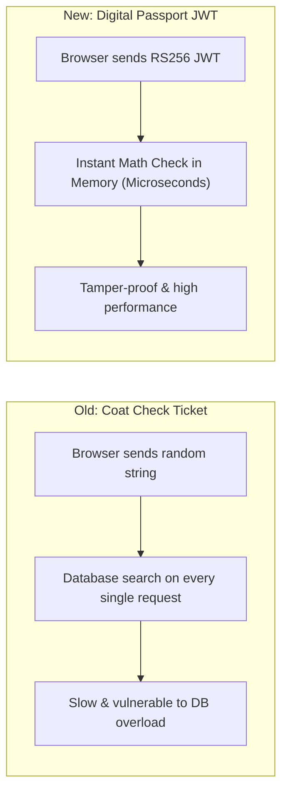
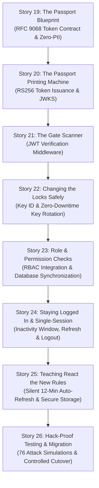

# Team Guide: How Authentication & Tokens Work in Veyra
### Simple, Plain-English Explanation of Stories VYR-019 through VYR-026

**Target Audience:** Development Team, QA, Product Managers, and Stakeholders  
**Scope:** Epic 3 — JWT/JWS Token Issuance, Verification, Session Lifecycle & Security  
**Branch Applicability:** Both `standard-veyra-application-dev` & `veyra-application-dev`  

---

## 1. The Big Picture: What Did We Change and Why?

### 🎟️ The Old Way (Pre-Epic 3: "Opaque Tokens")
Think of the old system like a **coat check ticket** at a venue:
- When you logged in, the server gave you a random string of numbers and letters (e.g. `a7f93b...82e1`).
- Every time you clicked a button in the app, your browser sent that random string to the server.
- The server had to stop what it was doing, go to the PostgreSQL database, and search: *"Who does ticket `a7f93b...` belong to? Is it still valid? Has it expired?"*
- **The Problem:** 
  - Every single API request put extra load on the database.
  - If a hacker sent completely random strings, the database still had to search for them.
  - The token had no built-in signature proving that our server actually created it.
  - Microsoft Entra ID (SSO) and Local logins handled tokens differently.

---

### 🛂 The New Way (Epic 3: "Digital Passports" / RS256 JWTs)
Think of the new system like an **electronic passport with a cryptographic hologram**:
- When you log in, the server gives you an **RS256 JSON Web Token (JWT)**.
- It contains verified, tamper-proof stamps: who issued it, who it's for, and exact expiration time.
- It is stamped with the server's **Secret Private Key**.
- When you send this passport with an API request, the server checks the stamp using its **Public Key in fractions of a millisecond in memory**.
- If anyone changes even a single letter inside the passport or tries to forge a stamp, the server instantly detects the tampering and rejects it **without even touching the database**.



---

## 2. Story-by-Story Breakdown (Stories 19 to 26)

Here is exactly what was built in each story in plain English:



---

### 🔹 Story VYR-019: "Designing the Passport" (Token Contract & Zero-PII)
- **Goal:** Decide exactly what goes inside the token and what is strictly forbidden.
- **Key Decisions:**
  - **15-Minute Lifetime:** Tokens are valid for exactly 15 minutes ($900\text{ seconds}$). If a token is stolen, the window of risk is very small.
  - **Zero-PII Rule (Privacy First):** The token contains **zero personal data**. No email addresses, no real names, no phone numbers, and no permission lists. It only holds anonymous technical IDs (`sub: userId`, `sid: sessionId`, `jti: tokenId`).
  - Even if someone inspects network traffic, they cannot read personal or sensitive information.

---

### 🔹 Story VYR-020: "The Passport Printer" (RS256 Issuance & JWKS Endpoint)
- **Goal:** Create the backend engine that signs and issues these tokens.
- **What Was Done:**
  - Created `backend/src/services/tokenService.ts`.
  - When a user logs in (via Local username/password or Microsoft Entra ID SSO), the backend signs the token using our server's **Private RSA Key**.
  - Created the public endpoint `GET /.well-known/jwks.json`. This publishes the server's **Public Key**, allowing internal services to verify tokens independently.

---

### 🔹 Story VYR-021: "The Scanner at the Gate" (Verification Middleware)
- **Goal:** Check tokens on incoming requests automatically.
- **What Was Done:**
  - Created `backend/src/middleware/jwtAuthMiddleware.ts`.
  - Before any protected API (like `/api/users` or `/api/dashboard`) runs, the middleware inspects the `Authorization: Bearer <token>` header.
  - It verifies:
    1. Is the cryptographic signature valid?
    2. Has the 15-minute token expired?
    3. Is the issuer really `veyra`?
    4. Is the audience really `veyra-api`?
  - If any check fails, it immediately returns **HTTP 401 Unauthorized** without doing heavy processing.

---

### 🔹 Story VYR-022: "Changing the Locks Safely" (Key Rotation)
- **Goal:** Allow the security team to rotate cryptographic keys without disconnecting active users.
- **What Was Done:**
  - Every key has a unique identifier called `kid` (e.g. `veyra-key-2026-q4`).
  - When a new key is introduced, both the old and new keys remain in the JWKS key set for a short overlap window.
  - Users holding tokens signed with the previous key continue to work until their next refresh, eliminating sudden login disruptions.

---

### 🔹 Story VYR-023: "Checking Roles at the Door" (RBAC Integration)
- **Goal:** Ensure user roles and permissions stay 100% accurate in real time.
- **The Challenge:** If a user's role is stored inside the token and an administrator demotes them from `AUDIT_MANAGER` to `AUDIT_USER`, they could keep manager privileges until their token expires!
- **Our Solution:**
  - The token proves **Identity** (who you are).
  - The database proves **Authorization** (what you are currently allowed to do).
  - Every API call checks the user's live role and account status in the database. If an administrator deactivates an account or removes a role, access is cut off **on their very next click**.

---

### 🔹 Story VYR-024: "Session Lifecycle, Refresh & Single-Session Control"
- **Goal:** Manage inactivity timers, smooth session renewal, and prevent multiple simultaneous logins.
- **Key Features:**
  - **15-Minute Sliding Inactivity Timer:** If a user leaves their computer idle for 15 minutes, the session expires.
  - **Session Refresh (`POST /api/auth/refresh`):** If the user is actively working, their session is renewed and a fresh JWT is issued.
  - **Single Active Session (Concurrent Login Control):**
    - If User A is logged in on a laptop, and someone logs into the same account on a desktop:
    - The server detects the active session and returns **HTTP 409 Conflict**.
    - If the user clicks **"Force Login"**, the desktop gets a new session and the laptop session is **immediately revoked**.
  - **Logout (`POST /api/auth/logout`):** Instantly invalidates the session in the database and server cache.

---

### 🔹 Story VYR-025: "Teaching the React Frontend" (Client Lifecycle)
- **Goal:** Update the frontend React application to handle the new token seamlessly.
- **What Was Done:**
  - **Silent Background Refresh:** The frontend automatically calls `/api/auth/refresh` every **12 minutes** (3 minutes before the 15-minute token expires). The user never gets interrupted while actively working.
  - **Secure Storage:** The token is kept in browser `sessionStorage` (so it vanishes automatically if the browser tab is closed).
  - **Graceful Expiry:** If the user steps away from their desk for over 15 minutes, the API returns `SESSION_EXPIRED`. The frontend intercepts this, clears local storage, and cleanly redirects them to the login screen with an informative message.

---

### 🔹 Story VYR-026: "Testing, Penetration Simulation & Migration"
- **Goal:** Prove the system cannot be hacked and migrate existing users safely.
- **What Was Done:**
  - Built an exhaustive automated test suite with **76 penetration test cases** (`npm run test:vyr26`):
    - ❌ Forged signatures -> Blocked (HTTP 401).
    - ❌ Tampered payloads -> Blocked (HTTP 401).
    - ❌ Algorithm spoofing (`alg: none`) -> Blocked (HTTP 401).
    - ❌ Expired tokens -> Blocked (HTTP 401).
    - ❌ Revoked sessions -> Blocked (HTTP 401).
    - ❌ Disabled accounts -> Blocked (HTTP 403).
    - ❌ Demoted roles -> Blocked (HTTP 403).
  - **Backward-Compatibility Migration Flag:** Added `ALLOW_LEGACY_OPAQUE_TOKENS` environment variable. In transition mode, existing users with old 64-character tokens are allowed to make calls and are automatically upgraded to RS256 JWTs on their next refresh. Once migrated, legacy tokens are permanently turned off.

---

## 3. Summary Cheat-Sheet for the Team

| Story ID | Everyday Name | What It Does In 1 Sentence |
| :--- | :--- | :--- |
| **VYR-019** | **The Blueprint** | Defined a 15-minute RS256 token containing zero personal data (Zero-PII). |
| **VYR-020** | **The Printer** | Built backend signing service using RSA private key & published `/.well-known/jwks.json`. |
| **VYR-021** | **The Scanner** | Built middleware to verify token signatures in memory before running API code. |
| **VYR-022** | **The Locksmith** | Created zero-downtime key rotation so keys can be changed without logging users out. |
| **VYR-023** | **The Gatekeeper** | Connected token checks with live database RBAC so role demotions take effect instantly. |
| **VYR-024** | **The Lifecycle** | Built 15-min idle expiry, token refresh, instant logout, and single-session enforcement. |
| **VYR-025** | **The UI Partner** | Updated React to auto-refresh tokens silently at 12 minutes and handle timeouts cleanly. |
| **VYR-026** | **The Stress Test** | Verified 76 security attack scenarios and built the controlled legacy-token migration switch. |

---

## 4. How to Run the Verification Tests

Anyone on the team can run the full test suite locally by running these commands inside the `backend` folder:

```bash
# Run the complete Epic 3 Authentication & Token suite (Stories 19 through 26)
npm run test:epic3

# Or run Story 26 specifically (all 76 security test cases)
npm run test:vyr26
```

All 76 security assertions will pass with **0 failures**.
