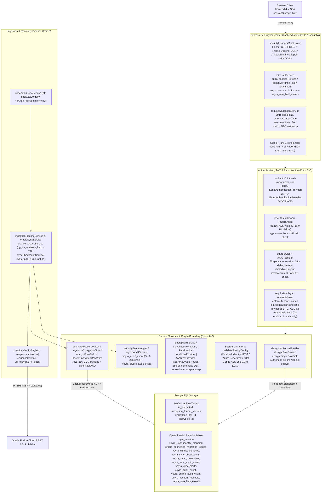
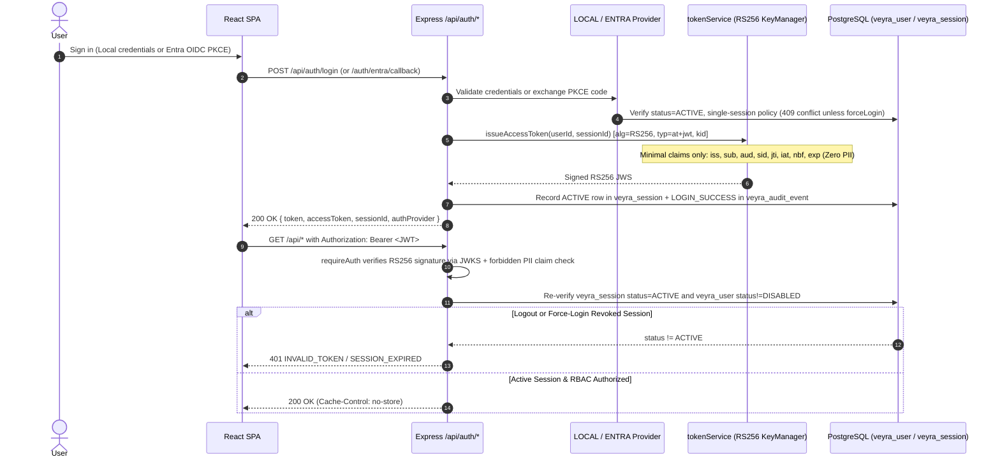
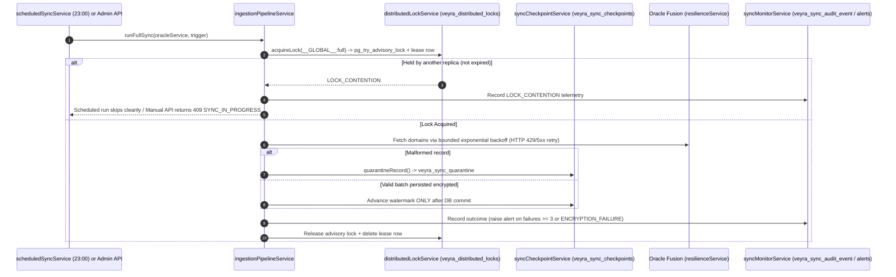

# VEYRA Security & API Architecture (VYR-064)

- **Story ID:** `VYR-064` (`EPIC 7 — Security, branch, regression and release testing`)
- **Branches Covered:**
  - `standard-veyra-application-dev` (AI-Free variant — no AskVeyra UI/routes/LLM dependencies)
  - `veyra-application-dev` (AI-Enabled variant — retains AskVeyra gated by `requireAskVeyra`)
- **Contract Version:** `v2.0.0` (Epics 1–7 Delivered Baseline)
- **Related Specifications:**
  - [VYR-061_CORE_REGRESSION_AND_API_CONTRACTS.md](../security/VYR-061_CORE_REGRESSION_AND_API_CONTRACTS.md)
  - [VYR-062_BUILD_AND_ARTIFACT_VALIDATION.md](../security/VYR-062_BUILD_AND_ARTIFACT_VALIDATION.md)
  - [VYR-063_SECURITY_ASSESSMENT_AND_REMEDIATION_REPORT.md](../security/VYR-063_SECURITY_ASSESSMENT_AND_REMEDIATION_REPORT.md)

---

## 1. End-to-End Security & Deployment Architecture

Veyra runs as a containerized Node.js 20 application (`Dockerfile` -> `npm run start:migrate` -> `node index.js` -> `backend/dist/index.js`) behind Railway / container TLS termination, serving the compiled React SPA (`frontend/dist`) and REST API (`/api/*`) from a single service while isolating PostgreSQL storage, KMS master keys, and Oracle Fusion integration boundaries.



---

## 2. Dual-Branch Variant Split (`standard-veyra-application-dev` vs `veyra-application-dev`)

Both branches share the exact security, authentication, encryption, ingestion, and OWASP ASVS L2 codebase while strictly separating generative-AI surface area:

| Architectural Layer | `standard-veyra-application-dev` (AI-Free) | `veyra-application-dev` (AI-Enabled) |
| :--- | :--- | :--- |
| **Frontend UI (`frontend/src`)** | Zero AskVeyra UI (`Assistant.tsx` removed), zero chat triggers, zero LLM endpoints in compiled JS bundle (`frontend/dist`) | Retains `Assistant.tsx` and conversational dashboard shortcuts |
| **API Routes (`backend/src/routes/api.ts`)** | `/api/chat`, `/api/ai/*`, and `/api/database/*` absent (**404 Not Found**) | `POST /api/chat` and AI routes active, guarded by `requireAuth` + `requireAskVeyra` (`AUDIT_SUPERVISOR` blocked with **403**) |
| **Backend Modules (`backend/src`)** | `backend/src/ai/` and `backend/src/tools/` absent | `backend/src/ai/orchestrator.ts`, `responseComposer.ts`, `backend/src/tools/index.ts` present |
| **Dependencies (`backend/package.json`)** | No LLM SDKs or `node-sql-parser` | Retains `@google/generative-ai` and `node-sql-parser` |
| **Startup Config (`configValidator.ts`)** | Boots with zero AI environment variables (`TOGETHER_API_KEY`, `GROQ_API_KEY` unnecessary) | Uses configured LLM keys or deterministic local NLU fallback |
| **Deployment Unit** | Standalone `Dockerfile` / `node index.js` | Standalone `Dockerfile` / `node index.js` |

---

## 3. Core Security Runtime Sequences

### 3.1 Dual-Provider Authentication & RS256 Token Cutover



### 3.2 Node.js-Only Envelope Encryption & Authorized Decryption Flow

```mermaid
sequenceDiagram
    autonumber
    participant Sync as Ingestion / Migration Worker
    participant Guard as ingestionEncryptionGuard / encryptedRecordWriter
    participant KMS as kmsProvider / KeyLifecycleRegistry
    participant PG as PostgreSQL Raw Table
    participant Reader as decryptedRecordReader
    participant Audit as cryptoAuditService

    Sync->>Guard: Persist raw Oracle record (VEYRA_RAW_ENCRYPTION=true)
    Guard->>Guard: Validate canonical AAD (tenant|table|id|v)
    Guard->>KMS: generateDataKey(ACTIVE keyId)
    Note over Guard,KMS: KMS wraps 256-bit random DEK; AES-256-GCM encrypts payload; DEK buffer zeroed
    KMS-->>Guard: encryptedDek + ACTIVE keyId
    Guard->>PG: Write EncryptedPayload JSON + is_encrypted=true, key_id, format_version, encrypted_at

    Note over Reader,PG: On authorized API request (after RBAC & tenant check)
    Reader->>PG: SELECT raw_payload + tracking cols + metadata cols
    Reader->>KMS: unwrapDek(encryptedDek, keyId) [allows ACTIVE, RETIRING, COMPROMISED]
    KMS-->>Reader: Plaintext DEK (fails closed if RETIRED or KMS unavailable)
    Reader->>Reader: AES-256-GCM verify authTag + AAD match -> JSON.parse -> zero DEK
    alt Tampering, AAD mismatch, or KMS outage
        Reader->>Audit: recordFailure(category, incidentId) [no plaintext/key logged]
        Reader-->>Sync: Throw ProtectedDataError (fail closed, zero plaintext fallback)
    else Verified
        Reader->>Audit: Aggregated DECRYPT SUCCESS telemetry (record_count, table)
        Reader-->>Sync: Plaintext object for DTO mapping (cipher fields stripped)
    end
```

### 3.3 Distributed Sync, Locking & Checkpoint Lifecycle



---

## 4. Delivered Security, Operations & Compliance API Reference

All endpoints below reflect exact paths and middleware guards verified in `backend/src/index.ts` and `backend/src/routes/api.ts`:

| Area | Endpoint | Auth / Guard | Purpose |
| :--- | :--- | :--- | :--- |
| **Health & Discovery** | `GET /health`, `GET /api/health` | Public (`helmet`) | Container liveness & Railway health check (`120s` timeout) |
| **JWKS Public Keys** | `GET /.well-known/jwks.json`, `GET /api/.well-known/jwks.json` | Public | RFC 7517 RSA public keys (`active` + `JWT_PREVIOUS_KEY_ID` during rollover) |
| **Auth Config & Login** | `GET /api/auth/provider`, `GET /api/auth/config`, `GET /api/auth/entra/start`, `POST /api/auth/entra/callback`, `POST /api/auth/login` | Public + `authRateLimiter` + `validateBody` | Discovery, OIDC PKCE callback, Local login returning RS256 JWS |
| **Session Lifecycle** | `GET /api/auth/status`, `POST /api/auth/refresh`, `POST /api/auth/logout`, `POST /api/auth/reset-password` | `requireAuth` / `sessionRefreshRateLimiter` / `authRateLimiter` | Session check, sliding JWT rotation (upgrading legacy tokens in Phase 2), revocation, password reset |
| **Investigations** | `POST /api/investigations`, `GET /api/investigations/:id` | `requireAuth` + `isInvestigationAuthorized` | Owner or `SITE_ADMIN` scoped snapshot store (`403` + `PRIVILEGED_DATA_ACCESS` audit on IDOR) |
| **Crypto & Sync Health** | `GET /api/security/crypto-health`, `GET /api/security/ingestion-status`, `GET /api/security/sync-monitor`, `GET /api/security/sync-history`, `GET /api/security/sync-alerts` | `requireAdmin` | Crypto failure counters/503 status, ingestion metrics, sync monitor alerts & history |
| **Sync & Lock Recovery** | `GET /api/admin/sync/status`, `POST /api/admin/sync/full`, `GET /api/admin/locks`, `POST /api/admin/locks/recover-stale`, `POST /api/admin/locks/force-release` | `requireAuth` (status) / `requireAdmin` + `sensitiveAdminRateLimiter` | Inspect/trigger baseline sync and recover stale or stuck distributed locks |
| **Checkpoints & Quarantine** | `GET /api/admin/sync/checkpoints`, `GET /api/admin/sync/quarantine`, `POST /api/admin/sync/quarantine/:id/resolve` | `requireAdmin` | Inspect watermarks and triage or resolve dead-lettered records |
| **Secrets & Credential Rotation** | `GET /api/admin/security/secrets-status`, `POST /api/admin/security/rotate-secret`, `GET /api/admin/credentials/health`, `POST /api/admin/credentials/rotate` | `requireAdmin` + `sensitiveAdminRateLimiter` | Non-secret fingerprint/validation report and hot rotation for `oracle`, `jwt`, `kms`, `database` |
| **Abuse & Session Admin** | `POST /api/admin/sessions/cleanup`, `GET /api/admin/security/rate-limits`, `POST /api/admin/users/:email/unlock`, `POST /api/admin/security/rate-limits/reset` | `requireAdmin` | Expired session cleanup, brute-force account unlock, rate-limit diagnostics |
