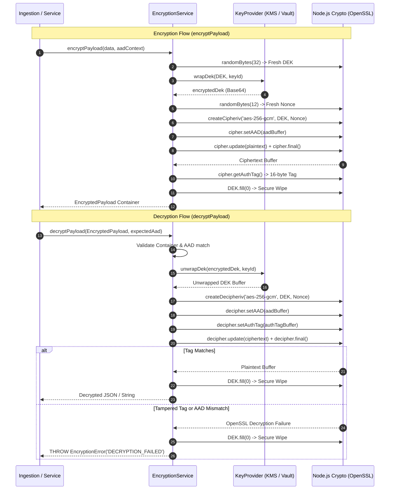

# AES-256-GCM Encryption & Decryption Cryptographic Service

**Story ID:** VYR-029  
**Epic:** EPIC 4 — Oracle raw-data encryption and Node.js-only decryption  
**Branch Applicability:** Both (`standard-veyra-application-dev` & `veyra-application-dev`)  
**Dependencies:** VYR-028 (*Encryption contract, AAD and storage schema*)  
**Status:** Approved & Verified  

---

## 1. Executive Summary & Objective

Story **VYR-029** provides the foundational, reusable cryptographic engine (**`EncryptionService`**) responsible for encrypting Oracle Fusion raw records before they are persisted into PostgreSQL, and decrypting them inside Node.js after authorization checks.

The implementation guarantees:
1. **Authenticated Encryption with Associated Data (AEAD):** Strict use of **AES-256-GCM** with 96-bit (12-byte) initialization vectors / nonces generated fresh per operation and 128-bit (16-byte) authentication tags.
2. **Fail-Closed Security & Zero Fallback:** Any tampered ciphertext, altered nonce, mismatched authentication tag, or transplanted AAD throws a typed `EncryptionError` and immediately halts execution. Plaintext is **never** emitted as fallback.
3. **Envelope Encryption & Key Provider Abstraction:** Payload data is encrypted with a unique 256-bit Data Encryption Key (DEK). The DEK is wrapped using the active Key Encryption Key (KEK) via the `KeyProvider` interface, preparing the system for AWS KMS / Azure Key Vault integration in **VYR-030**.
4. **Memory Hygiene:** Plaintext DEK buffers in Node.js heap memory are explicitly zeroized (`dek.fill(0)`) inside `finally` blocks immediately after cipher/decipher finalization.

---

## 2. Cryptographic Architecture & Flow



---

## 3. Cryptographic Primitives & Parameter Specifications

| Parameter | Primitive / Value | Standard / RFC | Security Rationale |
| :--- | :--- | :--- | :--- |
| **Cipher Algorithm** | `aes-256-gcm` | NIST SP 800-38D | High-throughput hardware-accelerated AEAD mode providing confidentiality and integrity simultaneously. |
| **Data Key Size (DEK)**| 256 bits (32 bytes) | FIPS 197 | Quantum-resistant symmetric key length protecting raw employee and financial records. |
| **Nonce / IV Size** | 96 bits (12 bytes) | NIST SP 800-38D §5.2.1.1 | Optimal GCM nonce size avoiding extra GHASH computations. Generated via `crypto.randomBytes(12)`. |
| **Authentication Tag** | 128 bits (16 bytes) | NIST SP 800-38D | Maximum standard authentication tag length, providing $2^{128}$ forge-resistance. |
| **Master Key (KEK)** | 256 bits (32 bytes) | RFC 3394 / NIST | Key Encryption Key stored in key manager, used exclusively to wrap/unwrap DEKs. |
| **AAD Binding** | Canonical string | VYR-028 Specification | Binds tenant, table, and entity natural key to the authentication tag. |

---

## 4. Key Provider Architecture & Envelope Encryption

### 4.1 Two-Tier Envelope Architecture & KeyProvider
In high-volume enterprise systems, performing direct KMS calls for every single row insertion introduces significant latency and cost. Veyra utilizes **envelope encryption**:
1. For each record or batch, a fresh 256-bit symmetric **DEK** is generated locally using a cryptographically secure pseudo-random number generator (`crypto.randomBytes`).
2. The payload is encrypted with this DEK.
3. The DEK itself is wrapped using the **Master Key (KEK)** via `keyProvider.wrapDek()`.
4. Only the wrapped DEK (`encryptedDek`) is persisted alongside the ciphertext in the database.
5. In Node.js memory, the plaintext DEK is overwritten with zeros (`dek.fill(0)`) immediately after cipher finalization.

The `KeyProvider` interface decouples key storage from encryption logic. In Epic 4, `LocalKeyProvider` manages root master keys and key ring rotation, paving the way for AWS KMS / Azure Key Vault integration in Story **VYR-030**.

### 4.2 Key Rotation Independence
The `EncryptedPayload` records the exact `keyId` of the Master Key used to wrap the DEK:
- When a new key (e.g. `veyra-kms-k2-2027`) is activated, new writes wrap their DEK with `k2`.
- Historical records reference `k1-2026`.
- During decryption, `unwrapDek` routes the request to the matching key version.
- Re-encryption of historical records can occur lazily or as a background migration batch (**VYR-036 / VYR-037**).

---

## 5. Fail-Closed Security & Tamper Simulation Matrix

Under all error conditions, `EncryptionService` fails closed. It **never** returns plaintext as fallback or logs sensitive decrypted material.

| Adversarial Attack / Anomaly | Test Scenario | Expected Outcome | Security Property Enforced |
| :--- | :--- | :--- | :--- |
| **Tampered Ciphertext** | Attacker flips a single bit in the Base64 ciphertext. | **Throws `EncryptionError('DECRYPTION_FAILED')`** | GHASH tag verification fails; no partial plaintext is disclosed. |
| **Altered Nonce** | Attacker mutates the nonce in the payload container. | **Throws `EncryptionError('DECRYPTION_FAILED')`** | GCM keystream mismatch causes authentication tag rejection. |
| **Corrupted Auth Tag** | Attacker modifies the 16-byte authentication tag. | **Throws `EncryptionError('DECRYPTION_FAILED')`** | Immediate rejection before ciphertext processing. |
| **Altered AAD** | Attacker changes `id=user_a` to `id=user_b` in the AAD. | **Throws `EncryptionError('DECRYPTION_FAILED')`** | AAD is verified by the GHASH tag; altering AAD invalidates the tag. |
| **Transplanted Record** | Attacker copies ciphertext from Dev tenant to Prod tenant. | **Throws `EncryptionError('AAD_MISMATCH')` / `DECRYPTION_FAILED`** | Expected AAD does not match payload AAD; decryption is blocked. |
| **Unknown Key ID** | Payload presents a `keyId` not present in key provider. | **Throws `EncryptionError('KEY_NOT_FOUND')`** | Decryption fails closed without default-key fallback. |
| **Invalid Nonce Length** | Nonce is not exactly 12 bytes (96 bits). | **Throws `EncryptionError('INVALID_CONTAINER')`** | Strict contract enforcement. |

---

## 6. Service API Surface

The `EncryptionService` exposes clean, high-level methods for integration across the platform:

```typescript
// 1. Core payload encryption & decryption
public async encryptPayload(data: string | object | Buffer, aad: string | AadContext, options?: { keyId?: string }): Promise<EncryptedPayload>;
public async decryptPayload<T = any>(payload: EncryptedPayload | string, expectedAad?: string | AadContext): Promise<T>;

// 2. High-level table entity helpers (for Ingestion & Read routes)
public async encryptEntityRecord(tableName: string, record: any, rawField: string, environmentHost: string): Promise<EncryptedPayload>;
public async decryptEntityRecord<T = any>(tableName: string, record: any, rawColumnValue: any, environmentHost: string): Promise<T>;

// 3. Key rotation re-encryption helper
public async rotatePayloadKey(payload: EncryptedPayload, newKeyId?: string): Promise<EncryptedPayload>;
```

---

## 7. Acceptance Criteria Verification Checklist

| Criterion | Requirement | Verification Method | Status |
| :--- | :--- | :--- | :---: |
| **AC1** | **Round-trip tests pass for representative Oracle payloads.** | Verified encryption and decryption of SCIM users, audit records, control definitions, and incident arrays with 100% byte-for-byte fidelity. | **PASS** |
| **AC2** | **Tampered ciphertext, nonce, tag or AAD fails decryption.** | Verified negative assertions for bit-flipped ciphertext, altered nonces, corrupted tags, altered AAD, and cross-tenant transplantation; all throw `EncryptionError`. | **PASS** |
| **AC3** | **Encryption failures stop persistence of sensitive plaintext.** | Verified fail-closed error propagation; zero plaintext fallback exists in any decryption or key resolution path. | **PASS** |
