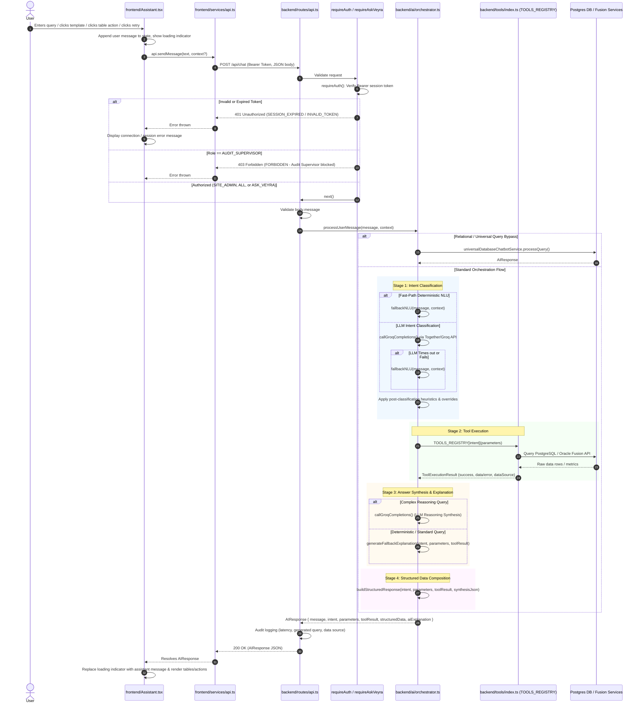

# Ask VEYRA Request Flow & Orchestrator Baseline Specification (Story 101.1)

## 1. Executive Summary & Objective

This document establishes the verified architectural baseline for the **Ask VEYRA** conversational AI and security investigation service prior to planned decomposition (VEYRA-101 / VEYRA-102). It traces the end-to-end request lifecycle from user interaction in the frontend to database querying and response rendering.

No functional behavior is modified by this story.

---

## 2. End-to-End Request Flow Sequence Diagram



---

## 3. Traced Question Submission Mechanisms

All question submissions enter `Assistant.tsx` through one of five user paths:

### 3.1 Primary Chat Input Bar
- **Source**: Text input and Enter key handling (`frontend/src/pages/Assistant.tsx`, lines 520–524, 1351–1354, 1455–1468, 2190–2196).
- **Trigger**: User types a query into `chatInputRef` or `commandInputRef` and either presses `Enter` (without `Shift`) or clicks the submit button (`ArrowUp` icon).
- **Handler**: `handleSend(inputValue)` is invoked.

### 3.2 Suggested Templates (Quick Questions)
- **Source**: `frontend/src/pages/Assistant.tsx`, lines 271–274, 2141–2155.
- **Trigger**: Clickable pills below the input bar for common queries (e.g., *"Who has the <role name> role?"*, *"Which roles are assigned to <username>?"*).
- **Behavior**: Clicking a template sets `inputValue` and focuses the input field with placeholder token selected for instant user editing.

### 3.3 External / Dashboard Injection (`initialQuestion`)
- **Source**: `frontend/src/pages/Assistant.tsx`, lines 401–418.
- **Trigger**: User clicks an "Ask VEYRA" shortcut on another page (e.g. Dashboard or Incident review) passing `initialQuestion`.
- **Behavior**: Populates `inputValue` and focuses cursor onto the text; explicitly **does not auto-submit** to allow user inspection before sending.

### 3.4 Table Interactive Chips / Follow-up Actions
- **Source**: `frontend/src/pages/Assistant.tsx`, lines 656 and 748 via `PaginatedTable` (`onAskQuestion={(q) => handleSend(q)}`).
- **Trigger**: In structured data tables, clicking on interactive cell chips (such as linked role names or user tags) triggers a contextual follow-up question.
- **Behavior**: Directly invokes `handleSend(question)`.

### 3.5 Retry & Resubmit Actions
- **Retry Failed Query**: `frontend/src/pages/Assistant.tsx`, lines 885–894. Filters messages for the last user prompt and re-invokes `handleSend(lastUserMsg.text)`.
- **Edit & Resubmit**: `frontend/src/pages/Assistant.tsx`, lines 471–505. Truncates subsequent message history, updates the edited prompt in place, and calls `api.sendMessage(text)` with a fresh loading state.

---

## 4. Frontend-to-Backend Protocol Contract

### 4.1 Client Call Specification
- **Function**: `api.sendMessage(message: string, context?: any)` in `frontend/src/services/api.ts` (lines 245–250).
- **Internal Delegator**: `apiRequest('/chat', { method: 'POST', body: JSON.stringify({ message, context }) })`.

### 4.2 HTTP Request Wire Format
- **Method**: `POST`
- **Full URL**: `${VITE_API_BASE_URL || ''}/api/chat`
- **Headers**:
  ```http
  Content-Type: application/json
  Authorization: Bearer <session_token>
  ```
  *(Token resolved by `getActiveAuthToken()` from `sessionStorage.getItem('authToken')` or investigation tab bridge).*
- **Request Body**:
  ```json
  {
    "message": "Who are the users without roles?",
    "context": {
      "entityType": "ROLE",
      "entityName": "IT Security Manager",
      "entityId": "ORA_IT_SEC_MGR",
      "currentView": "ROLE_CATALOG"
    }
  }
  ```
  *(Note: `context` is optional. In the current UI, `handleSend()` transmits `message` and omits `context`).*

### 4.3 HTTP Response Wire Format (Success: 200 OK)
```json
{
  "message": "Identified 2,054 users without any assigned security roles.",
  "intent": "SECURITY_STATISTICS",
  "parameters": {
    "targetMetric": "USERS_WITHOUT_ROLES"
  },
  "toolResult": {
    "tool": "SECURITY_STATISTICS",
    "parameters": { "targetMetric": "USERS_WITHOUT_ROLES" },
    "dataSource": "PostgreSQL Authoritative Database",
    "timestamp": "2026-11-04T10:15:30.123Z",
    "success": true,
    "data": { "usersWithoutRoles": 2054, "totalUsers": 3066 },
    "integrationRequired": false,
    "ambiguous": false
  },
  "structuredData": {
    "title": "Users Without Roles",
    "summary": "Found 2,054 inactive or unassigned identities...",
    "keyFindings": ["67% of total user base has zero assigned entitlements"],
    "riskHighlights": [],
    "table": {
      "columns": [{ "key": "username", "label": "Username" }],
      "rows": []
    },
    "actions": [
      { "label": "View User Directory", "actionType": "NAVIGATE", "params": { "page": "users" } }
    ],
    "isAiInvestigation": false
  },
  "aiExplanation": "User query requested count of unassigned user accounts."
}
```

### 4.4 HTTP Error Response Shapes
- **400 Bad Request**: `{ "error": "Message is required" }`
- **401 Unauthorized**: `{ "success": false, "code": "INVALID_TOKEN" | "SESSION_EXPIRED", "message": "..." }`
- **403 Forbidden**: `{ "success": false, "code": "FORBIDDEN", "message": "Access denied..." }`
- **500 Internal Server Error**: `{ "error": "AI Orchestration failed", "details": "<error message>" }`

---

## 5. Backend Authorization Pipeline

The `/api/chat` endpoint is guarded by a two-stage authorization chain:

1. **`requireAuth`** (`backend/src/routes/api.ts`, lines 62–104):
   - Extracts the `Bearer` token from the `Authorization` header.
   - Validates the token against the active session store via `authService.validateSession(token, true)`.
   - Rejects unauthenticated requests with `401 Unauthorized`.
   - Hydrates `res.locals` with session metadata: `userId`, `email`, `displayName`, `role`, `permissions`, `isAdmin`, and `token`.

2. **`requireAskVeyra`** (`backend/src/routes/api.ts`, lines 154–179):
   - Enforces Access Control Rule **AC8**: Any session where `role === 'AUDIT_SUPERVISOR'` is immediately blocked with `403 FORBIDDEN` (*"Audit Supervisor does not have privilege to access Ask Veyra"*).
   - Allows execution if the user has `isAdmin === true`, `role === 'SITE_ADMIN'`, or holds permissions `ALL` or `ASK_VEYRA`.
   - Denies all other roles with `403 FORBIDDEN`.

---

## 6. Backend Orchestrator Processing Stages

`processUserMessage(message, context)` in `backend/src/ai/orchestrator.ts` (lines 2164–2998) executes the following sequential pipeline:

```
[Incoming Request: message, context]
                 │
                 ▼
┌────────────────────────────────────────────────────────┐
│ Stage 0: Universal Database Routing Bypass             │
│ Checks for cross-table / SQL keywords                  │
│ (if matched -> universalDatabaseChatbotService)        │
└───────────────────────┬────────────────────────────────┘
                        │ No
                        ▼
┌────────────────────────────────────────────────────────┐
│ Stage 1: Intent Detection & Parameter Extraction       │
│ • Fast-Path NLU (fallbackNLU) if deterministic         │
│ • Groq/Together LLM call (callGroqCompletions)         │
│ • Error fallback to fallbackNLU if LLM fails/times out │
│ • Heuristic overrides (incident vs control rules)      │
└───────────────────────┬────────────────────────────────┘
                        │
                        ▼
┌────────────────────────────────────────────────────────┐
│ Stage 2: Controlled Tool Execution                     │
│ • Lookup TOOLS_REGISTRY[intentData.intent]             │
│ • Execute tool function with extracted parameters      │
│ • Catch errors & construct ToolExecutionResult         │
└───────────────────────┬────────────────────────────────┘
                        │
                        ▼
┌────────────────────────────────────────────────────────┐
│ Stage 3: Natural Language Answer Synthesis             │
│ • Dedicated intent synthesizers (Stats, Audit, etc.)   │
│ • LLM reasoning synthesis for complex queries          │
│ • Fallback text generation (generateFallbackExplanation)│
└───────────────────────┬────────────────────────────────┘
                        │
                        ▼
┌────────────────────────────────────────────────────────┐
│ Stage 4: Structured Data Composition                   │
│ • buildStructuredResponse(intent, params, toolResult)  │
│ • Construct tables, action buttons, risk badges        │
└───────────────────────┬────────────────────────────────┘
                        │
                        ▼
[Return AIResponse to Express Route Handler]
```

---

## 7. Tool Registry Index (`TOOLS_REGISTRY`)

Located at `backend/src/tools/index.ts` (lines 2038–2285). Contains **31 registered tools**:

| Intent / Registry Key | Implementing Tool Function | Primary Data Source |
| :--- | :--- | :--- |
| `APPLICATION_KNOWLEDGE` | `getApplicationKnowledgeTool` | In-memory governance knowledge base |
| `LIST_USERS` | `getUsersTool` | `oracle_raw_users` table |
| `GET_USER` | `getUserTool` | `oracle_raw_users` table |
| `ROLES_BY_USER` | `getUserTool` | `oracle_raw_users` (assigned roles array) |
| `LIST_ROLES` | `getRolesTool` | `oracle_raw_roles` table |
| `ROLE_SEARCH` | `getRolesTool` | `oracle_raw_roles` table |
| `GET_ROLE` | `getRolesTool` | `oracle_raw_roles` table |
| `ROLE_DETAILS` | `getRolesTool` | `oracle_raw_roles` table |
| `USERS_BY_ROLE` | `getUsersByRoleTool` | `oracle_raw_users` inverted role index |
| `AUDIT_HISTORY` | `getAuditHistoryTool` | `oracle_audit_events` / FSCM vault |
| `ROLE_HIERARCHY` | `getRoleHierarchyTool` | Role inheritance graph service |
| `ROLE_PRIVILEGES` | `getPrivilegesForRoleTool` | Role-to-privilege entitlements map |
| `ROLES_BY_PRIVILEGE` | `getRolesByPrivilegeTool` | Reverse privilege-to-roles map |
| `USERS_BY_PRIVILEGE` | `getUsersByPrivilegeTool` | Multi-hop privilege user resolution |
| `PRIVILEGES_BY_USER` | `getPrivilegesByUserTool` | Effective user privilege compilation |
| `USER_ACCESS` | `getPrivilegesForRoleTool` | Access point entitlement validation |
| `RISK_INFORMATION` | `getRiskIncidentsTool` | `oracle_control_incidents` table |
| `ACCESS_REQUESTS` | `getAccessRequestsTool` | Fusion Risk Management access requests |
| `ADVANCED_CONTROLS` | `getAdvancedControlsTool` | `oracle_raw_controls` table |
| `CERTIFICATIONS_OVERVIEW`| `getCertificationsOverviewTool` | Access certification campaigns |
| `CERTIFICATIONS_LIST` | `listCertificationsTool` | Access certification campaigns |
| `CERTIFICATION_DETAILS` | `getCertificationDetailsTool` | Detailed certification worksheet |
| `CERTIFIER_WORKSHEET` | `getCertifierWorksheetTool` | Certification worksheet line items |
| `CONTROLS_OVERVIEW` | `getControlsOverviewTool` | Control catalog metrics |
| `CONTROLS_LIST` | `listControlsTool` | `oracle_raw_controls` table |
| `CONTROL_DETAILS` | `getControlDetailsTool` | Detailed control definitions |
| `INCIDENTS_LIST` | `listIncidentsTool` | `oracle_control_incidents` |
| `INCIDENT_DETAILS` | `getIncidentDetailsTool` | Individual incident audit record |
| `ACCESS_CERTIFICATIONS` | `getAccessCertificationsTool` | Certification summaries |
| `SECURITY_STATISTICS` | *Inline async handler* | Summaries from `oracle_raw_users`, `oracle_raw_roles`, `oracle_control_incidents` |
| `UNIVERSAL_DATABASE_QUERY`| `universalDatabaseChatbotService.processQuery` | Schema-wide SQL introspection engine |

---

## 8. Orchestrator Decomposition Responsibility Map

The existing `backend/src/ai/orchestrator.ts` file contains **4,035 lines** serving multiple distinct architectural responsibilities. Below is the mapped plan for incremental decomposition across VEYRA-101 and VEYRA-102:

```mermaid
graph TD
    subgraph Current Monolith: orchestrator.ts [4,035 lines]
        A["Lines 1-23: Interfaces (AIResponse, IntentExtraction)"]
        B["Lines 24-1568: fallbackNLU() (Regex & Keyword Matchers)"]
        C["Lines 1569-2163: generateFallbackExplanation() (Text Templates)"]
        D["Lines 2164-2276: LLM Client & Query Classifier"]
        E["Lines 2277-2475: Intent Detection Pipeline & Prompts"]
        F["Lines 2476-2494: Tool Invocation & Error Handling"]
        G["Lines 2495-2984: Answer Synthesis & Reasoning"]
        H["Lines 3000-4035: buildStructuredResponse() (UI Model Formatter)"]
    end

    subgraph Target Target Decomposed Modules
        M1["src/ai/types.ts<br/>Contracts & Interfaces"]
        M2["src/ai/intent/fallbackNLU.ts<br/>Deterministic Pattern Matchers"]
        M3["src/ai/synthesis/textGenerators.ts<br/>Fallback Explanations"]
        M4["src/ai/llm/client.ts<br/>LLM Transport & Failover"]
        M5["src/ai/intent/intentClassifier.ts<br/>Prompt Formulation & Parsing"]
        M6["src/ai/tools/toolRouter.ts<br/>Execution & Tool Error Encapsulation"]
        M7["src/ai/synthesis/answerSynthesizer.ts<br/>Reasoning & Synthesis"]
        M8["src/ai/formatters/structuredResponseBuilder.ts<br/>Table/Card View Models"]
    end

    A -.-> M1
    B -.-> M2
    C -.-> M3
    D -.-> M4
    E -.-> M5
    F -.-> M6
    G -.-> M7
    H -.-> M8
```



### Responsibility Breakdown
1. **`fallbackNLU` (Lines 24–1568, ~1,545 lines)**:
   - *Current Responsibility*: Pure deterministic pattern matching on user input string and context.
   - *Extraction Safety for VEYRA-101*: **High**. Completely isolated function with zero external side-effects or network dependencies.
2. **`generateFallbackExplanation` (Lines 1569–2163, ~595 lines)**:
   - *Current Responsibility*: Static markdown string formatting based on tool execution data.
   - *Extraction Safety*: **High**. Pure functions mapping `(intent, params, toolResult)` to formatted strings.
3. **`buildStructuredResponse` (Lines 3000–4035, ~1,036 lines)**:
   - *Current Responsibility*: Transforms raw database output into frontend table columns, row objects, badges, and action buttons.
   - *Extraction Safety*: **Medium-High**. Pure UI view-model builder.
4. **`callGroqCompletions` & HTTP Transport (Lines 2181–2239, ~60 lines)**:
   - *Current Responsibility*: Axios HTTP call with timeout and model failover (`openai/gpt-oss-120b`).
   - *Extraction Safety*: **Medium**.
5. **Orchestrator Core (`processUserMessage`) (Lines 2164–2998, ~350 lines)**:
   - *Current Responsibility*: Pipeline controller coordinating stages 1–4.
   - *Target State*: Lean pipeline function (<100 lines) delegating to the modules above.

---

## 9. Discrepancies, Gaps & Open Questions

During code tracing, the following discrepancies were identified between documentation, frontend consumption, and backend behavior:

| # | Item | Observed Code Reality | Impact / Risk | Recommended Action |
| :- | :--- | :--- | :--- | :--- |
| **D-1** | Context passing in Frontend UI | `handleSend()` in `Assistant.tsx` only calls `api.sendMessage(text)` without passing `context`, even though `api.sendMessage(text, context)` and backend `/api/chat` support it. | Tests expecting context from normal UI clicks will see `context: undefined`. | Story VEYRA-102 should update `handleSend` to accept optional `context` or establish context-aware prompt testing fixtures. |
| **D-2** | `aiExplanation` field handling | `AIResponse` emits `aiExplanation: intentData.explanation`, but `Assistant.tsx` drops `aiExplanation` when constructing its internal `Message` object. | `aiExplanation` is unused in the UI. | Retain in backend contract for backward compatibility and test verification; document as unused in frontend. |
| **D-3** | `ToolExecutionResult.ambiguous` | `ToolExecutionResult` contains `ambiguous?: boolean`, used by `orchestrator.ts` to render partial tables when a query has multiple potential matches. | If fixtures omit `ambiguous`, type guards or tests could fail on ambiguous flows. | Include `ambiguous?: boolean` in all regression test fixture schemas. |
| **D-4** | HTTP 500 Error Schema | When an unhandled orchestrator exception occurs, the route returns `{ "error": "AI Orchestration failed", "details": string }`, not an `AIResponse` shape. | Frontend handles connection errors in catch block, but doesn't receive structured error codes. | Standardize backend error response fixture to test both 400, 401, 403, and 500 status codes. |
| **D-5** | Universal Database Query Bypass | Queries containing terms like "select ", "department-wise", "expir" bypass `processUserMessage` tool registry completely and route directly to `universalDatabaseChatbotService`. | Decomposing orchestrator must preserve this bypass before intent classification. | Include an automated test specifically testing this bypass routing behavior. |

---

## 10. Verified Files & Functions Reference

- `frontend/src/pages/Assistant.tsx`
  - `handleSend()` (lines 420–469)
  - `handleEditAndResubmit()` (lines 471–505)
  - `renderStructuredMessage()` (lines 546–810)
  - `initialQuestion` effect (lines 401–418)
- `frontend/src/services/api.ts`
  - `sendMessage()` (lines 245–250)
  - `apiRequest()` (lines 62–105)
  - `getActiveAuthToken()` (lines 5–39)
- `backend/src/index.ts`
  - Route mounting: `app.use('/api', apiRouter)` (line 60)
- `backend/src/routes/api.ts`
  - `POST /api/chat` handler (lines 1735–1807)
  - `requireAuth()` (lines 62–104)
  - `requireAskVeyra()` (lines 154–179)
- `backend/src/ai/orchestrator.ts`
  - `AIResponse` interface (lines 8–15)
  - `fallbackNLU()` (lines 24–1568)
  - `generateFallbackExplanation()` (lines 1569–2163)
  - `callGroqCompletions()` (lines 2181–2239)
  - `processUserMessage()` (lines 2164–2998)
  - `buildStructuredResponse()` (lines 3000–4035)
- `backend/src/tools/index.ts`
  - `ToolExecutionResult` interface (lines 26–36)
  - `TOOLS_REGISTRY` (lines 2038–2285)

