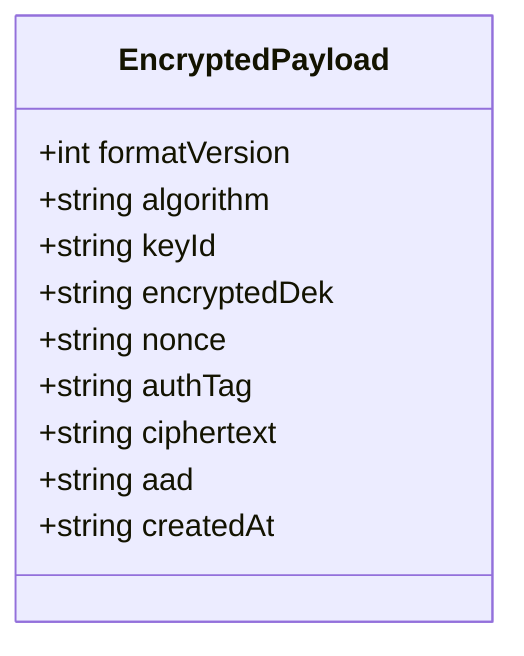
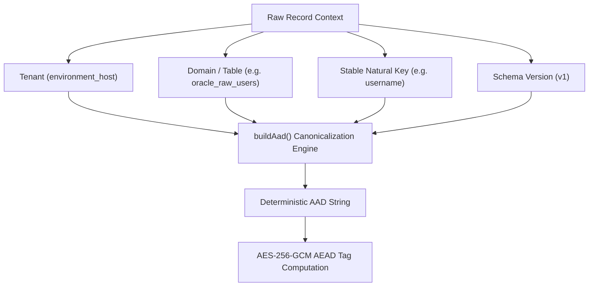
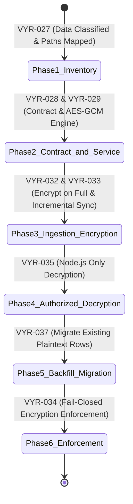

# Encryption Contract, Additional Authenticated Data (AAD) & Storage Schema Design

**Story ID:** VYR-028  
**Epic:** EPIC 4 — Oracle raw-data encryption and Node.js-only decryption  
**Branch Applicability:** Both (`standard-veyra-application-dev` & `veyra-application-dev`)  
**Dependencies:** VYR-027 (*Data classification and persistence path mapping*)  
**Status:** Approved & Formally Specified  

---

## 1. Executive Summary & Objective

Story **VYR-028** defines the canonical, versioned cryptographic container format (**`EncryptedPayload`**), the Additional Authenticated Data (**AAD**) construction rules, and the PostgreSQL storage schema strategy for encrypting Oracle Fusion raw records at rest.

Building upon the data classification established in **VYR-027**, this architecture guarantees:
1. **Confidentiality & Integrity:** All raw JSON payloads containing PII, financial audit data, and SOD conflict definitions are encrypted using authenticated **AES-256-GCM**.
2. **Context Binding via AAD:** Every ciphertext payload is cryptographically bound to its tenant, table, and entity identifier, preventing ciphertext splice, relocation, and replay attacks.
3. **Decryption After Key Rotation:** The container explicitly carries key identifiers (`keyId`) and envelope-wrapped Data Encryption Keys (`encryptedDek`), ensuring existing ciphertext remains decryptable across multiple key rollover generations.
4. **Zero Downtime & Query Compatibility:** The storage schema supports both legacy plaintext and encrypted records during the migration window while keeping approved reporting metadata queryable in indexed PostgreSQL columns.

---

## 2. Versioned `EncryptedPayload` Container Contract

All encrypted records across background ingestion pipelines, database repositories, and service caches conform to the versioned **`EncryptedPayload`** specification defined in [encryptionContract.ts](file:///C:/Users/Sravanth.claaps/Oracle-rmc%20-standard/backend/src/security/encryptionContract.ts).



### Field Specification:

| Field Name | Type | Size / Format | Description & Security Purpose |
| :--- | :--- | :--- | :--- |
| **`formatVersion`** | `number` | Positive integer (`1`) | Identifies the container specification version. Ensures future cryptographic upgrades (e.g. quantum-resistant ciphers) can be phased in safely. |
| **`algorithm`** | `string` | Literal `'AES-256-GCM'` | Cryptographic primitive used. Strict validation prevents algorithm confusion or downgrade attacks. |
| **`keyId`** | `string` | Unique string (e.g. `veyra-kms-k1-2026`) | Identifies the Key Encryption Key (KEK) / master key used to wrap the DEK or encrypt the record. Essential for key rotation. |
| **`encryptedDek`** | `string` | Base64 string (32 bytes ciphertext) | Envelope-wrapped 256-bit AES Data Encryption Key. When direct KMS encryption is used, holds the key reference or URI. |
| **`nonce`** | `string` | Base64 string (12 bytes = 16 chars) | Cryptographically secure 96-bit Initialization Vector. **Must be uniquely generated for every single encryption operation**. |
| **`authTag`** | `string` | Base64 string (16 bytes = 24 chars) | 128-bit GCM authentication tag. Validated during decryption to ensure neither the ciphertext nor the AAD has been altered. |
| **`ciphertext`** | `string` | Base64 string | Encrypted payload bytes containing the serialized raw JSON document. |
| **`aad`** | `string` | Canonical string | The exact AAD string bound during encryption, facilitating audit verification and integrity checking. |
| **`createdAt`** | `string` | ISO 8601 UTC timestamp | Record encryption timestamp. |

---

## 3. Additional Authenticated Data (AAD) Construction & Threat Modeling

### 3.1 The Context-Binding Principle
AES-256-GCM provides **Authenticated Encryption with Associated Data (AEAD)**. While ciphertext confidentiality protects data from being read, AEAD allows plaintext context (the AAD) to be cryptographically bound into the authentication tag calculation.

$$\text{AuthTag} = \text{GHASH}_{H}(\text{AAD} \parallel \text{Ciphertext} \parallel \text{Lengths})$$

If an attacker alters the AAD or attempts to attach the ciphertext to a different record, GCM tag verification fails, and decryption fails closed.

### 3.2 Canonical AAD Format
All services generate AAD using the deterministic `buildAad()` utility:

$$\text{AAD} = \text{tenant}=\langle\text{host}\rangle \mid \text{table}=\langle\text{table}\rangle \mid \text{id}=\langle\text{recordId}\rangle \mid \text{v}=\langle\text{version}\rangle$$

- Characters `|` and `=` are backslash-escaped (`\|`, `\=`) to prevent injection or parameter pollution.
- All hostnames and table names are lowercased and trimmed.



### 3.3 AAD Threat Mitigation Matrix:

| Attack Vector | Threat Scenario | How AAD Prevents the Attack |
| :--- | :--- | :--- |
| **Cross-Tenant Transplantation** | Attacker takes valid encrypted employee records from Dev host (`eiiv-dev14...`) and copies the ciphertext into Prod host (`eiiv-prod1...`). | **Blocked:** The AAD contains `tenant=eiiv-dev14...`. When Prod attempts decryption with AAD `tenant=eiiv-prod1...`, GCM authentication fails immediately with `ERR_AEAD_TAG_VERIFICATION_FAILED`. |
| **Cross-Table Splicing** | Attacker copies ciphertext from `oracle_raw_access_certifications` into `oracle_raw_controls`. | **Blocked:** The AAD binds `table=oracle_raw_access_certifications`. Reading from `oracle_raw_controls` generates a different AAD, failing decryption. |
| **Intra-Table Entity Spoofing** | Attacker swaps the encrypted profile of Administrator User A into the row of Regular User B in `oracle_raw_users`. | **Blocked:** The AAD binds `id=user_a`. Decryption for user B presents AAD `id=user_b`, resulting in cryptographic rejection. |

### 3.4 Table-to-AAD Natural Key Mapping:

| PostgreSQL Table | Target Raw Column | Natural Record Identifier (`id`) | Canonical AAD Example |
| :--- | :--- | :--- | :--- |
| `oracle_raw_audit_records` | `raw_payload` | `record_unique_hash` | `tenant=eiiv-dev14...\|table=oracle_raw_audit_records\|id=8a7c...\|v=v1` |
| `oracle_raw_users` | `raw_user` | `username` | `tenant=eiiv-dev14...\|table=oracle_raw_users\|id=akash.meesarapu\|v=v1` |
| `oracle_raw_roles` | `raw_role` | `role_code` | `tenant=eiiv-dev14...\|table=oracle_raw_roles\|id=ORA_FND_IT_SEC_JOB\|v=v1` |
| `oracle_raw_role_hierarchy` | `raw_record` | `${parent_role_name}:${child_role_name}` | `tenant=eiiv-dev14...\|table=oracle_raw_role_hierarchy\|id=Admin:Duty1\|v=v1` |
| `oracle_raw_controls` | `raw_payload` | `control_id` | `tenant=eiiv-dev14...\|table=oracle_raw_controls\|id=CTRL_101\|v=v1` |
| `oracle_control_incidents` | `raw_incidents` | `control_id` | `tenant=eiiv-dev14...\|table=oracle_control_incidents\|id=CTRL_101\|v=v1` |
| `oracle_incident_rows` | `raw` | `${control_id}:${ord}` | `tenant=eiiv-dev14...\|table=oracle_incident_rows\|id=CTRL_101:42\|v=v1` |
| `oracle_raw_access_certifications`| `raw_data` | `certification_id` | `tenant=eiiv-dev14...\|table=oracle_raw_access_certifications\|id=CERT_99\|v=v1` |
| `oracle_raw_certifier_worksheets` | `raw_data` | `${certification_id}:${id}` | `tenant=eiiv-dev14...\|table=oracle_raw_certifier_worksheets\|id=CERT_99:1001\|v=v1` |

---

## 4. Envelope Encryption & Key Rotation Architecture

To support cryptographic key rotation without requiring all historical database records to be immediately re-encrypted:

```mermaid
flowchart TD
    subgraph KMS / Key Vault
        KEK1["Master Key 1 (keyId: k1-2026)"]
        KEK2["Master Key 2 (keyId: k2-2027 - Active)"]
    end

    subgraph Record A (Encrypted in 2026)
        P1["EncryptedPayload A<br/>keyId: k1-2026<br/>encryptedDek: [DEK encrypted with KEK1]"]
    end

    subgraph Record B (Encrypted in 2027)
        P2["EncryptedPayload B<br/>keyId: k2-2027<br/>encryptedDek: [DEK encrypted with KEK2]"]
    end

    P1 -- Decrypt DEK using KEK1 --> DEK_A["DEK A"]
    DEK_A -- Decrypt Ciphertext --> PlaintextA["Plaintext Record A"]

    P2 -- Decrypt DEK using KEK2 --> DEK_B["DEK B"]
    DEK_B -- Decrypt Ciphertext --> PlaintextB["Plaintext Record B"]
```

1. **Two-Tier Key Hierarchy:**
   - **Key Encryption Key (KEK):** Stored in secure KMS / Key Vault (or local secure vault in dev). Never leaves the secure enclave.
   - **Data Encryption Key (DEK):** A 256-bit symmetric key used to encrypt the payload. The DEK itself is encrypted using the KEK and stored in `encryptedDek`.
2. **Key Rotation Independence:**
   - When KEK rotates from `k1` to `k2`, new writes use `k2`.
   - Existing rows with `keyId: 'k1'` remain completely decryptable because the decryption service resolves the matching key version referenced by `keyId`.
   - Re-encryption of legacy ciphertext can occur as an asynchronous background task (Story **VYR-036 / VYR-037**) without blocking API operations.

---

## 5. PostgreSQL Storage Schema & Query Compatibility

### 5.1 Dual-Mode Embedded Container Approach
Rather than creating separate shadow tables, Veyra adopts a **Dual-Mode JSONB Storage Strategy**:
- In PostgreSQL, the raw payload columns (`raw_payload`, `raw_user`, `raw_role`, `raw_record`, `raw_incidents`, `raw_data`, `raw`) are defined as `JSONB`.
- An `EncryptedPayload` is serialized as a standard JSON object containing the cryptographic fields.
- **Why this is superior:**
  1. No disruptive `ALTER TABLE` DDL migrations required on multi-gigabyte production tables.
  2. The database column naturally accommodates both legacy plaintext JSON records and new `EncryptedPayload` containers.
  3. Backup and replication tools handle the data transparently.

### 5.2 Discriminating Legacy vs. Encrypted Records
The `isEncryptedPayload(value)` discriminator dynamically inspects the row:
- If `value.formatVersion && value.algorithm === 'AES-256-GCM' && value.ciphertext && value.nonce && value.authTag`, it is treated as **Encrypted**.
- Otherwise, it is treated as **Legacy Plaintext**.

This provides a seamless, zero-downtime bridge during the rolling migration window (Stories VYR-035 and VYR-037).

### 5.3 Query Compatibility Preservation
As proven in Story **VYR-027**, PostgreSQL queries for dashboard cards, filters, and reports **never query raw JSONB directly**:
- All search filters (`username`, `email`, `lifecycle`, `priority`, `product`, `business_object`) operate on indexed relational columns.
- All aggregate counts (`total_incidents`, `assigned_incidents`, `member_count`) operate on first-class integer columns.
- Decryption is invoked strictly in Node.js on the paginated result set (max 25–50 rows) before sending minimized DTOs to React.

---

## 6. Migration Lifecycle Strategy

The migration path follows a four-phase rollout:



---

## 7. Acceptance Criteria Verification Checklist

| Criterion | Requirement | Verification Method | Status |
| :--- | :--- | :--- | :---: |
| **AC1** | **Encryption contract is versioned and documented.** | `EncryptedPayload` TypeScript interface with `formatVersion`, `algorithm`, `keyId`, `encryptedDek`, `nonce`, `authTag`, `ciphertext`, and `aad` defined and documented. | **APPROVED** |
| **AC2** | **Storage supports decryption after key rotation.** | Key ID tracking (`keyId`) and envelope encryption metadata (`encryptedDek`) preserved in payload; verified across multi-key test scenarios. | **APPROVED** |
| **AC3** | **AAD prevents ciphertext being silently moved between record contexts.** | Deterministic `buildAad()` and `buildTableRecordAad()` binding `tenant`, `table`, `recordId`, and `schemaVersion`; verified against transposition attacks. | **APPROVED** |
