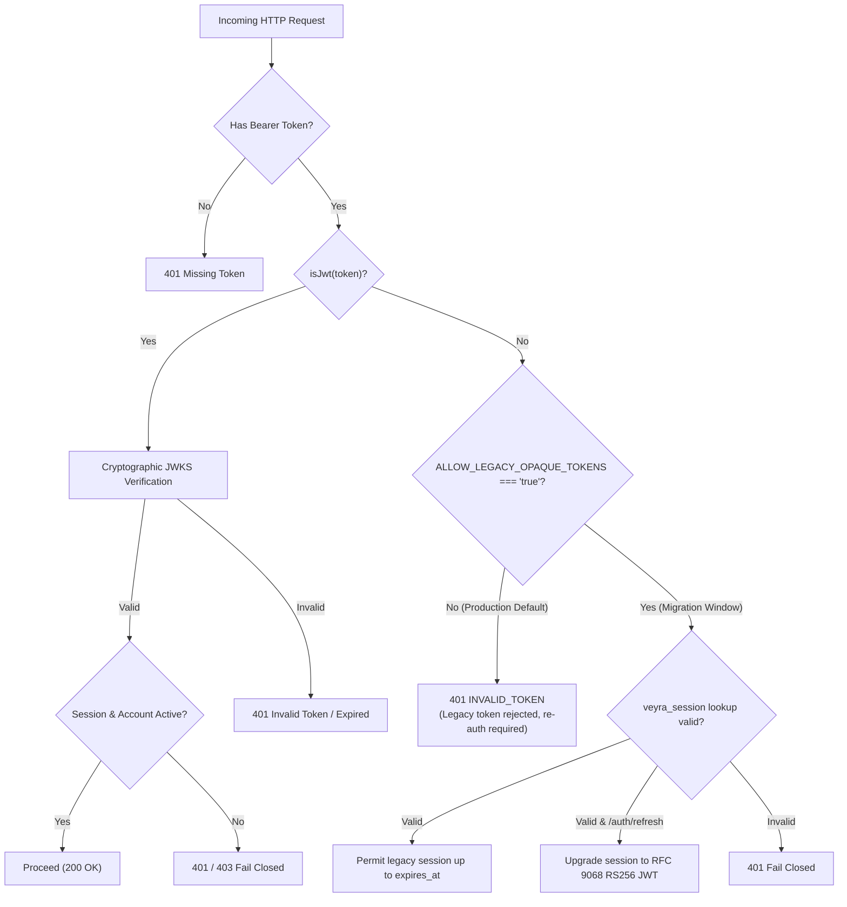

# JWT Security Verification & Backward-Compatibility Migration Strategy

**Story ID:** VYR-026  
**Epic:** EPIC 3 — JWT/JWS issuance, verification and session integration  
**Branch Applicability:** Both (`standard-veyra-application-dev` & `veyra-application-dev`)  
**Status:** Approved & Verified  

---

## 1. Executive Summary & Objective

Story **VYR-026** verifies that the Veyra JSON Web Token (JWT) architecture, cryptographic verification pipeline, active session lifecycles, and backward-compatibility transitions are impervious to tampering and fail closed under all adversarial conditions.

This document formalizes:
1. **The Fail-Closed Security Verification Matrix** (forged signatures, expired tokens, wrong issuer/audience, unknown `kid`, revoked `sid`, disabled accounts, and stale roles).
2. **The Backward-Compatibility Migration Strategy** (governing old opaque 64-character hex tokens during and after the planned migration window).
3. **Cross-Provider Contract Parity** (proving that both Microsoft Entra ID and Local authentication issue identical RFC 9068 RS256 tokens).
4. **Branch Synchronization** (guaranteeing unified behavior across AI-free and standard branches).

---

## 2. Threat Modeling & Security Verification Matrix

In accordance with Acceptance Criteria 1 (*"All token-negative tests fail closed"*), all authentication and authorization boundaries enforce immediate rejection without disclosing internal telemetry or error traces.

| Threat / Test Vector | Test Scenario | Expected Outcome | Security Rationale |
| :--- | :--- | :--- | :--- |
| **Forged Signature** | Attacker modifies payload claims (e.g. escalating `role` to `SITE_ADMIN`) and recalculates signature with rogue key, or tampers with bytes in token signature | **HTTP 401 `INVALID_TOKEN`** | Cryptographic verification via `jose.jwtVerify()` against the authoritative public key in JWKS fails. |
| **Algorithm Spoofing** | Attacker sets `alg: 'none'` (RFC 7519 §8.5 bypass) or submits HMAC-SHA256 (`HS256`) signed with public key | **HTTP 401 `INVALID_TOKEN`** | Strict header enforcement: only `RS256` is accepted (`header.alg === 'RS256'`). All other algorithms rejected prior to verification. |
| **Expired Token** | Attacker presents an authentic RS256 token whose `exp` claim is in the past ($> 15\text{ minutes}$) | **HTTP 401 `SESSION_EXPIRED`** | Time-based expiry verified by `jwtVerify()` with a tight 5-second clock skew tolerance. |
| **Untrusted Issuer (`iss`)** | Token signed with a valid key but asserting an external or unauthorized issuer (`iss !== https://api.veyra.local`) | **HTTP 401 `INVALID_TOKEN`** | Strict issuer validation rejects rogue identity providers or cross-tenant tokens. |
| **Untrusted Audience (`aud`)** | Token intended for another application/service (`aud !== https://api.veyra.local/v1`) | **HTTP 401 `INVALID_TOKEN`** | RFC 9068 audience confinement prevents token redirection and privilege escalation across disparate microservices. |
| **Unknown Key ID (`kid`)** | Token header references a `kid` not present in active or rotated JWKS key sets | **HTTP 401 `INVALID_TOKEN`** | Key resolution fails closed. Key manager never attempts verification against default or arbitrary keys. |
| **Revoked Session (`sid`) via Force-Login** | User executes a force-login from a second device, superseding their prior active session | **HTTP 401 `SESSION_EXPIRED`** | Server-side `veyra_session` state is updated to `EXPIRED`. Sub-claim validation detects invalid `sid` and halts access immediately. |
| **Revoked Session (`sid`) via Logout** | User invokes `POST /api/auth/logout` | **HTTP 401 `INVALID_TOKEN`** | Explicit logout marks `veyra_session.status = 'LOGGED_OUT'` and deletes cached session. Prior JWT cannot access any protected endpoint. |
| **Inactivity Sliding Window Expiry** | User remains idle exceeding 15 minutes ($900,000\text{ ms}$) without invoking `/api/auth/refresh` | **HTTP 401 `SESSION_EXPIRED`** | Session activity timestamp check fails; session is transitioned to `EXPIRED` in database and cache. |
| **Disabled User Account** | System Administrator deactivates user (`status = 'DISABLED'` or `status = 'INACTIVE'`) | **HTTP 403 `USER_DISABLED`** | `verifyJwtAndSession` re-checks database user state on every protected invocation, instantly cutting off compromised identities. |
| **Stale Role / Privilege Demotion** | User's role is demoted in database from `AUDIT_MANAGER` to `AUDIT_USER` during an active session | **HTTP 403 `FORBIDDEN`** | Route-level RBAC (`requirePrivilege`) checks authoritative database permissions, preventing stale JWT claims from bypassing access control. |

---

## 3. Backward-Compatibility & Token Migration Strategy

### 3.1 Migration Architecture Decision
Prior to Epic 3 (Stories VYR-019 through VYR-025), Veyra issued 64-character random hex opaque tokens stored directly in `veyra_session.session_id`.

To ensure seamless production deployment, Veyra implements a **controlled two-phase migration policy**:



### 3.2 Strategy Execution Details

1. **Phase 1 — Default Fail-Closed Production Posture (`ALLOW_LEGACY_OPAQUE_TOKENS=false`):**
   - By default in production, all incoming tokens must strictly conform to RFC 9068 compact RS256 JWS.
   - Any legacy opaque token received on `/api/*` endpoints fails closed immediately with HTTP 401:
     ```json
     {
       "success": false,
       "code": "INVALID_TOKEN",
       "message": "Legacy authentication token rejected. RFC 9068 RS256 JWT access token required. Please sign in again."
     }
     ```
   - **React Client Handling:** As implemented in Story VYR-025, the React client intercepts the 401 response, purges `sessionStorage`, and dispatches `auth:expired`, prompting the user to log in and obtain a modern JWT without manual intervention.

2. **Phase 2 — Time-Bounded Migration Window (`ALLOW_LEGACY_OPAQUE_TOKENS=true`):**
   - In environments where zero abrupt session terminations are mandated during rolling container deployments, setting `ALLOW_LEGACY_OPAQUE_TOKENS=true` enables backward-compatible session resolution.
   - Legacy opaque tokens present in `veyra_session` remain functional strictly until their existing sliding inactivity timeout (maximum 15 minutes).
   - **Automatic Token Upgrade:** When an active legacy session calls `POST /api/auth/refresh`, `authService.refreshSessionActivity()` issues a signed RS256 JWT access token and returns it to the client, transparently upgrading the client session.
   - Once the deployment cutover window (e.g. 1 hour) has elapsed, `ALLOW_LEGACY_OPAQUE_TOKENS` is removed/set to `false`.

---

## 4. Cross-Provider Token Contract Parity

In compliance with Acceptance Criteria 4, both **Local Authentication** (`LOCAL`) and **Microsoft Entra ID** (`ENTRA`) issue identical Veyra JWT access tokens conforming to the V1 contract:

### 4.1 Protected Header
```json
{
  "alg": "RS256",
  "typ": "at+jwt",
  "kid": "veyra-key-1"
}
```

`kid` resolves from `JWT_KEY_ID` (default `veyra-key-1`) and is republished on rotation (VYR-022).

### 4.2 Payload Claims
```json
{
  "iss": "veyra",
  "sub": "b2c1d3e4-f5a6-4b7c-8d9e-0f1a2b3c4d5e",
  "aud": "veyra-api",
  "iat": 1794462000,
  "nbf": 1794462000,
  "exp": 1794462900,
  "jti": "7f8a9b0c-1d2e-3f4a-5b6c-7d8e9f0a1b2c",
  "sid": "e3f4a5b6-7c8d-9e0f-1a2b-3c4d5e6f7a8b"
}
```

`iss` and `aud` default to `veyra` / `veyra-api` and are overridable per deployment via `JWT_ISSUER` and `JWT_AUDIENCE`. Both issuance and verification read these from `backend/src/auth/jwtContract.ts`, so the documented contract and runtime behaviour cannot drift apart.

#### 4.3 Zero-PII Claim Policy

Veyra JWTs are **signed, not encrypted** — anyone holding a token can read its payload. The contract therefore carries *no* identity or authorization data. The following claims are rejected at both issuance and verification (`VEYRA_JWT_FORBIDDEN_CLAIMS`):

`email` · `upn` · `preferred_username` · `name` · `display_name` · `roles` · `groups` · `permissions` · `password` · `password_hash` · `token`

A token presenting any of them fails closed with HTTP 401 `INVALID_TOKEN` **even when its signature is authentic**.

Consequently, **identity, role, permissions and `auth_provider` are never claims** — they are resolved server-side from `veyra_session` and `veyra_user` on every request. This is what makes mid-session account disablement and role demotion take effect immediately (section 2) instead of waiting for token expiry.

*Note:* The provider (`LOCAL` or `ENTRA`) is recorded in server-side session state only. Both providers call the identical `tokenService.issueAccessToken()` path, so the header, claim set, signature algorithm, verification rules and session lifecycle are byte-for-byte identical; only `sid`, `jti` and timestamps differ between logins.

---

## 5. Automated Verification Test Suite

Story VYR-026 is verified by a dedicated automated suite:

`backend/scripts/test_story_026_jwt_security_and_migration.cjs`

```bash
npm --prefix backend run build     # the suite runs against dist/
npm --prefix backend run test:vyr26
```

The suite boots the real `apiRouter` on port 5099 against the live PostgreSQL instance, signs adversarial tokens with the **real** active signing key so each negative proves a verification rule rather than a broken endpoint, and restores every database row and environment flag it mutates in a `finally` block.

### 5.1 Suite Structure

| Section | Coverage | Story step / AC |
| :--- | :--- | :--- |
| **1. Cryptographic fail-closed** | Control (authentic token accepted), forged signature with rogue key, bit-flipped signature, unsigned payload tampering, `alg:"none"`, HS256 algorithm confusion, wrong `typ`, expired `exp`, untrusted `iss`, foreign `aud`, unknown `kid`, missing `kid`, smuggled PII claim, unbound `sid`, `sub`/session mismatch, malformed credential, absent header, and no internal disclosure in error bodies | Step 1 · AC1 |
| **2. Session security & revocation** | Concurrent login 409, incumbent session survival, force-login revocation, refresh rotation, refresh cannot resurrect a revoked session, 15-minute inactivity expiry, logout revocation | Step 3 · AC1 |
| **3. Identity state & dynamic authorization** | Mid-session account disablement (403 `USER_DISABLED`), restoration, mid-session role demotion (403 `FORBIDDEN`), restoration proving RBAC reads live DB state | Step 1 · AC1 |
| **4. Backward-compatibility migration** | Phase 1 rejection and client-contract error code, JWT unaffected, Phase 2 acceptance, automatic refresh upgrade, crypto not weakened during the window, unknown opaque token still fails closed, revoked session not resurrected, cutover closes the window | Step 2 · AC2 |
| **5. Cross-provider contract parity** | LOCAL and ENTRA header/claim-set equality, required claims present, zero forbidden claims, matching `iss`/`aud`/lifetime, unique `sid`/`jti`, shared verification pipeline, provider held in session state | Step 4 · AC3 |
| **6. Documentation & regression harness** | This document matches the runtime contract; every Epic 3 suite is present and runnable | AC2 · AC3 |

### 5.2 Epic 3 Authentication Regression (AC3)

```bash
npm --prefix backend run test:epic3
```

Runs VYR-019, VYR-020, VYR-022, VYR-023, VYR-024, VYR-025 and VYR-026 in sequence and fails on the first non-zero exit. Both branches must pass this command before release.

> **Known harness gap:** VYR-021 (JWT verification middleware) has no dedicated suite of its own. Its behaviour is covered in substance by section 1 above, which exercises every verification rule in `tokenService.verifyAccessToken()` end-to-end through the middleware. A standalone `test:vyr21` remains outstanding against that story.

### 5.3 Test Fixtures

| Fixture | Used for |
| :--- | :--- |
| `akash.meesarapu@claaps.com` (AUDIT_MANAGER) | Baseline session, forged-token impersonation target, parity checks |
| `audit.user@claaps.com` (AUDIT_USER) | Inactivity-expiry session |
| `user@claaps.com` (AUDIT_MANAGER) | Mid-session account disablement — restored to `ACTIVE` on exit |
| `manager.user@claaps.com` (AUDIT_MANAGER) | Mid-session role demotion against `GET /api/audit/products` — role restored on exit |

The suite is destructive against these rows while it runs. Point it at a non-production database.
