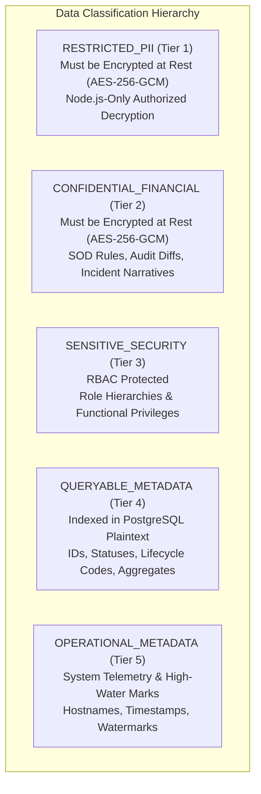
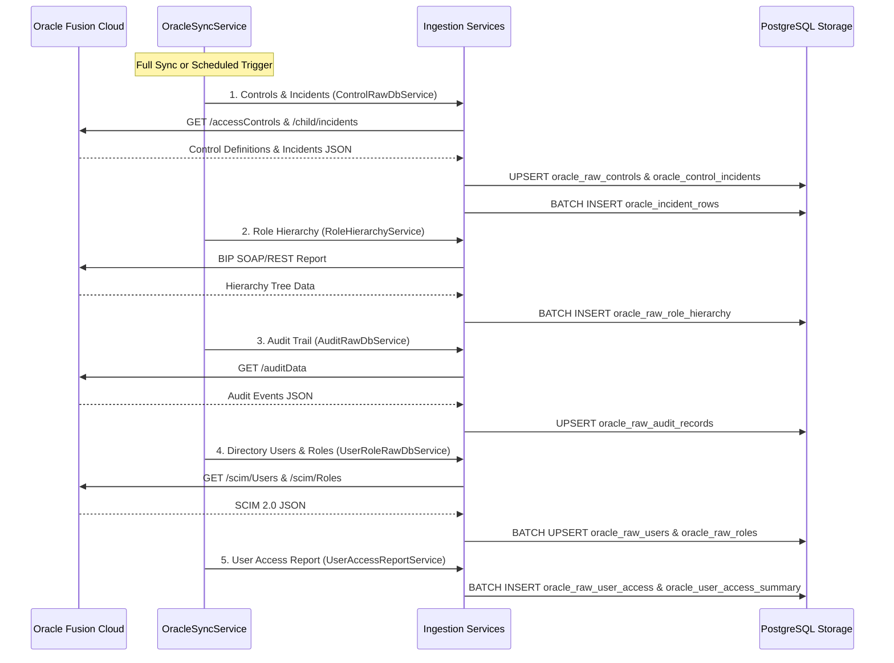
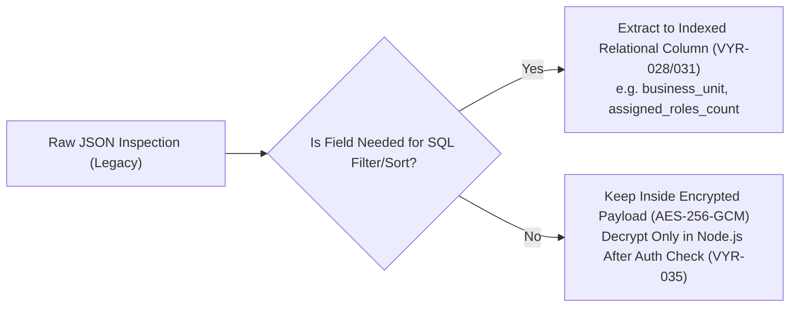

# Oracle Fusion Data Classification & Persistence Path Mapping

**Story ID:** VYR-027  
**Epic:** EPIC 4 — Oracle raw-data encryption and Node.js-only decryption  
**Branch Applicability:** Both (`standard-veyra-application-dev` & `veyra-application-dev`)  
**Status:** Approved & Formally Mapped  

---

## 1. Executive Summary & Objective

Story **VYR-027** establishes the foundational data governance and security inventory required for **Epic 4** (*Oracle raw-data encryption and Node.js-only decryption*). 

The primary objectives of this architecture are:
1. **Identify and classify all Oracle Fusion data stored across PostgreSQL tables**, separating restricted Personally Identifiable Information (PII) and sensitive financial/SOD data that **must be encrypted at rest** from operational and queryable metadata that must remain indexed.
2. **Trace every Oracle ingestion pipeline** (manual and scheduled synchronization jobs) to ensure encryption boundaries cannot be bypassed regardless of how data enters the system.
3. **Trace every API retrieval path** to enforce that decryption occurs strictly within Node.js service layers post-authorization, preventing encryption keys or unauthorized raw payloads from leaking to React or external consumers.
4. **Document all SQL, JSONB, and report dependencies** on raw JSON blobs (`raw_payload`, `raw_user`, `raw_role`, `raw_record`, `raw_incidents`, `raw_data`, `raw`), outlining the exact migration path to prevent performance degradation or query breaks when ciphertext is introduced in VYR-028 through VYR-035.

---

## 2. Data Classification Taxonomy & Principles

In compliance with enterprise compliance standards (GDPR, SOC 2 Type II, ISO/IEC 27001, and Oracle SaaS Security Guidelines), data elements in Veyra are categorized into five distinct tiers:

| Classification Level | Definition & Sensitivity | Encryption Mandate | Permitted in SQL Filters / GROUP BY |
| :--- | :--- | :--- | :--- |
| **`RESTRICTED_PII`** | Individual identity elements: emails, given/family names, person IDs, phone numbers, employee badge IDs, manager references, and raw SCIM user objects. | **MANDATORY** in raw JSON storage. | **NO** direct SQL filtering on encrypted JSON. Must use designated indexed search columns or in-memory filtering post-decryption. |
| **`CONFIDENTIAL_FINANCIAL`** | Segregation of Duties (SOD) violations, transaction amounts, journal entry modifications, raw audit diffs, and control violation payloads. | **MANDATORY** in raw JSON storage. | **NO** direct SQL operators on ciphertext. Quantitative metrics and counts must be maintained in queryable columns. |
| **`SENSITIVE_SECURITY`** | Role structure mappings, duty role combinations, functional privilege codes, and access point specifications. | Selective / Payload encryption. | **YES** via indexed relational columns (`role_code`, `parent_role_name`, `child_role_name`). |
| **`QUERYABLE_METADATA`** | Dimension attributes, primary/foreign keys, lifecycle statuses, categorical flags, and pre-computed counts required for sub-millisecond dashboard queries. | **PLAINTEXT / INDEXED** (Not encrypted; validated via AAD). | **YES** (Optimized for `WHERE`, `ORDER BY`, `LIMIT / OFFSET`, and relational joins). |
| **`OPERATIONAL_METADATA`** | Environment host isolation keys, sync watermarks, sync statuses, and error diagnostic logs. | **PLAINTEXT** | **YES** (Core routing and multi-tenant isolation). |

---

## 3. Authoritative PostgreSQL Table & Column Classification Matrix

Below is the complete inventory of all 15 Oracle-related PostgreSQL tables evaluated in Veyra:

### 3.1 Raw Entity & Payload Tables (Containing Raw JSON Blobs)

#### 1. `oracle_raw_audit_records`
*Domain:* Audit Trail & Event Monitoring  
*Raw JSON Column:* `raw_payload` (JSONB) — **MANDATORY ENCRYPTION**  
*AAD Components (VYR-028):* `[environment_host, product, business_object, record_unique_hash]`

| Column Name | Data Type | Sensitivity | Encrypted in Epic 4? | Queryable Metadata? | Justification & Role |
| :--- | :--- | :--- | :---: | :---: | :--- |
| `id` | `bigint` | `QUERYABLE_METADATA` | No | Yes | Primary key sequence. |
| `environment_host` | `varchar(255)` | `OPERATIONAL_METADATA` | No | Yes | Multi-tenant environment isolation & AAD binding. |
| `product` | `varchar(150)` | `QUERYABLE_METADATA` | No | Yes | Indexed Oracle product line filter (HCM, Financials, RACM). |
| `business_object` | `varchar(255)` | `QUERYABLE_METADATA` | No | Yes | Indexed business entity filter (User, Journal, Role). |
| `record_unique_hash`| `varchar(64)` | `QUERYABLE_METADATA` | No | Yes | SHA-256 deduplication fingerprint of event attributes. |
| `event_timestamp` | `timestamptz` | `QUERYABLE_METADATA` | No | Yes | Indexed date-range filtering and sorting. |
| `username` | `varchar(150)` | `RESTRICTED_PII` | No | Yes | Pseudonymized principal indexed for search filter. |
| `event_type` | `varchar(100)` | `QUERYABLE_METADATA` | No | Yes | Action filter (CREATE, UPDATE, DELETE). |
| **`raw_payload`** | `jsonb` | **`RESTRICTED_PII`** | **YES** | **No** | **Full auditData array with before/after attribute states and PII.** |
| `created_at` | `timestamptz` | `OPERATIONAL_METADATA` | No | Yes | Audit logging timestamp. |

---

#### 2. `oracle_raw_users`
*Domain:* Identity Directory & User Accounts  
*Raw JSON Column:* `raw_user` (JSONB) — **MANDATORY ENCRYPTION**  
*AAD Components (VYR-028):* `[environment_host, username]`

| Column Name | Data Type | Sensitivity | Encrypted in Epic 4? | Queryable Metadata? | Justification & Role |
| :--- | :--- | :--- | :---: | :---: | :--- |
| `environment_host` | `varchar(255)` | `OPERATIONAL_METADATA` | No | Yes | Environment tenant binding. |
| `username` | `varchar` | `RESTRICTED_PII` | No | Yes | Natural identifier indexed for search and logins. |
| `display_name` | `varchar` | `RESTRICTED_PII` | No | Yes | User full name for UI presentation and directory search. |
| `email` | `varchar` | `RESTRICTED_PII` | No | Yes | Indexed for duplicate account detection. |
| `is_active` | `boolean` | `QUERYABLE_METADATA` | No | Yes | Active status filter. |
| `user_category` | `varchar` | `QUERYABLE_METADATA` | No | Yes | Category filter (DEFAULT, SYSTEM). |
| **`raw_user`** | `jsonb` | **`RESTRICTED_PII`** | **YES** | **No** | **Full SCIM 2.0 user resource: emails, phone, roles, manager, HR data.** |
| `last_synced_at` | `timestamptz` | `OPERATIONAL_METADATA` | No | Yes | Synchronization timestamp. |
| `created_at` | `timestamptz` | `OPERATIONAL_METADATA` | No | Yes | Record creation timestamp. |
| `updated_at` | `timestamptz` | `OPERATIONAL_METADATA` | No | Yes | Record update timestamp. |

---

#### 3. `oracle_raw_roles`
*Domain:* Security & Role-Based Access Control Catalog  
*Raw JSON Column:* `raw_role` (JSONB) — **MANDATORY ENCRYPTION**  
*AAD Components (VYR-028):* `[environment_host, role_code]`

| Column Name | Data Type | Sensitivity | Encrypted in Epic 4? | Queryable Metadata? | Justification & Role |
| :--- | :--- | :--- | :---: | :---: | :--- |
| `environment_host` | `varchar(255)` | `OPERATIONAL_METADATA` | No | Yes | Environment tenant binding. |
| `role_code` | `varchar` | `QUERYABLE_METADATA` | No | Yes | Oracle role code (e.g. `ORA_GL_GENERAL_ACCOUNTANT_DUTY`). |
| `role_name` | `varchar` | `QUERYABLE_METADATA` | No | Yes | Human-readable title of the security role. |
| `category` | `varchar` | `QUERYABLE_METADATA` | No | Yes | Role category (Job, Duty, Abstract, Data, GRC, Other). |
| `is_custom` | `boolean` | `QUERYABLE_METADATA` | No | Yes | Custom vs seeded role indicator. |
| `member_count` | `integer` | `QUERYABLE_METADATA` | No | Yes | Pre-computed member count for catalog sorting. |
| **`raw_role`** | `jsonb` | **`SENSITIVE_SECURITY`** | **YES** | **No** | **Full SCIM role representation with complete members array.** |
| `last_synced_at` | `timestamptz` | `OPERATIONAL_METADATA` | No | Yes | Sync timestamp. |
| `created_at` | `timestamptz` | `OPERATIONAL_METADATA` | No | Yes | Record creation timestamp. |
| `updated_at` | `timestamptz` | `OPERATIONAL_METADATA` | No | Yes | Record update timestamp. |

---

#### 4. `oracle_raw_role_hierarchy`
*Domain:* Role Entitlement Tree & Functional Privileges  
*Raw JSON Column:* `raw_record` (JSONB) — **MANDATORY ENCRYPTION**  
*AAD Components (VYR-028):* `[environment_host, parent_role_name, child_role_name]`

| Column Name | Data Type | Sensitivity | Encrypted in Epic 4? | Queryable Metadata? | Justification & Role |
| :--- | :--- | :--- | :---: | :---: | :--- |
| `id` | `integer` | `QUERYABLE_METADATA` | No | Yes | Primary sequence key. |
| `environment_host` | `varchar(255)` | `OPERATIONAL_METADATA` | No | Yes | Tenant confinement. |
| `parent_role_name` | `varchar(500)` | `QUERYABLE_METADATA` | No | Yes | Parent role in hierarchy graph traversal. |
| `parent_role_type` | `varchar(100)` | `QUERYABLE_METADATA` | No | Yes | Parent role type (Job, Abstract). |
| `child_role_name` | `varchar(500)` | `QUERYABLE_METADATA` | No | Yes | Child role or privilege inherited by parent. |
| `child_role_type` | `varchar(100)` | `QUERYABLE_METADATA` | No | Yes | Child type (Duty, Privilege). |
| `role_code` | `varchar(255)` | `QUERYABLE_METADATA` | No | Yes | Role technical code. |
| `category` | `varchar(100)` | `QUERYABLE_METADATA` | No | Yes | Functional business domain. |
| `relationship_type`| `varchar(255)` | `QUERYABLE_METADATA` | No | Yes | Inheritance relation (Direct, Inherited). |
| **`raw_record`** | `jsonb` | **`SENSITIVE_SECURITY`** | **YES** | **No** | **Raw BI Publisher record payload.** |
| `last_synced_at` | `timestamptz` | `OPERATIONAL_METADATA` | No | Yes | Sync timestamp. |
| `created_at` | `timestamptz` | `OPERATIONAL_METADATA` | No | Yes | Insertion timestamp. |

---

#### 5. `oracle_raw_controls`
*Domain:* Advanced Access Controls (RMC / GRC)  
*Raw JSON Column:* `raw_payload` (JSONB) — **MANDATORY ENCRYPTION**  
*AAD Components (VYR-028):* `[environment_host, control_id]`

| Column Name | Data Type | Sensitivity | Encrypted in Epic 4? | Queryable Metadata? | Justification & Role |
| :--- | :--- | :--- | :---: | :---: | :--- |
| `environment_host` | `varchar(255)` | `OPERATIONAL_METADATA` | No | Yes | Tenant isolation. |
| `control_id` | `varchar` | `QUERYABLE_METADATA` | No | Yes | Oracle GRC control unique ID. |
| `name` | `varchar` | `QUERYABLE_METADATA` | No | Yes | Control policy rule name. |
| `state` | `varchar` | `QUERYABLE_METADATA` | No | Yes | Control lifecycle state (Approved, In Review). |
| `status` | `varchar` | `QUERYABLE_METADATA` | No | Yes | Control enforcement status (Active, Inactive). |
| `oracle_last_run_date` | `timestamptz` | `OPERATIONAL_METADATA` | No | Yes | Last execution date in Oracle. |
| `oracle_last_update_date` | `timestamptz` | `OPERATIONAL_METADATA` | No | Yes | Last update date in Oracle. |
| **`raw_payload`** | `jsonb` | **`CONFIDENTIAL_FINANCIAL`** | **YES** | **No** | **Full Oracle GRC Control REST resource (SOD logic, rules).** |
| `created_at` | `timestamptz` | `OPERATIONAL_METADATA` | No | Yes | Creation timestamp. |
| `updated_at` | `timestamptz` | `OPERATIONAL_METADATA` | No | Yes | Update timestamp. |

---

#### 6. `oracle_control_incidents`
*Domain:* Control Incidents Single-Cell Storage  
*Raw JSON Column:* `raw_incidents` (JSONB Array) — **MANDATORY ENCRYPTION**  
*AAD Components (VYR-028):* `[environment_host, control_id]`

| Column Name | Data Type | Sensitivity | Encrypted in Epic 4? | Queryable Metadata? | Justification & Role |
| :--- | :--- | :--- | :---: | :---: | :--- |
| `environment_host` | `varchar(255)` | `OPERATIONAL_METADATA` | No | Yes | Tenant isolation. |
| `control_id` | `varchar` | `QUERYABLE_METADATA` | No | Yes | Control identifier. |
| `control_name` | `varchar` | `QUERYABLE_METADATA` | No | Yes | Control title. |
| `total_incidents` | `integer` | `QUERYABLE_METADATA` | No | Yes | Pre-computed count for immediate UI metrics (<5ms). |
| `assigned_incidents` | `integer` | `QUERYABLE_METADATA` | No | Yes | Count of incidents in Assigned lifecycle status. |
| `accepted_incidents` | `integer` | `QUERYABLE_METADATA` | No | Yes | Count of incidents in Accepted risk status. |
| `remediate_incidents`| `integer` | `QUERYABLE_METADATA` | No | Yes | Count of incidents under Remediation. |
| `resolved_incidents` | `integer` | `QUERYABLE_METADATA` | No | Yes | Count of resolved incidents. |
| `last_oracle_update_date` | `timestamptz` | `OPERATIONAL_METADATA` | No | Yes | Watermark date. |
| `last_synced_at` | `timestamptz` | `OPERATIONAL_METADATA` | No | Yes | Sync timestamp. |
| `sync_status` | `varchar` | `OPERATIONAL_METADATA` | No | Yes | Status flag (SUCCESS, PARTIAL, FAILED). |
| **`raw_incidents`** | `jsonb` | **`CONFIDENTIAL_FINANCIAL`** | **YES** | **No** | **Consolidated single-cell JSON array of all raw incident rows.** |
| `created_at` | `timestamptz` | `OPERATIONAL_METADATA` | No | Yes | Creation timestamp. |
| `updated_at` | `timestamptz` | `OPERATIONAL_METADATA` | No | Yes | Update timestamp. |

---

#### 7. `oracle_incident_rows`
*Domain:* Normalized Granular Control Incidents  
*Raw JSON Column:* `raw` (JSONB) — **MANDATORY ENCRYPTION**  
*AAD Components (VYR-028):* `[environment_host, control_id, ord]`

| Column Name | Data Type | Sensitivity | Encrypted in Epic 4? | Queryable Metadata? | Justification & Role |
| :--- | :--- | :--- | :---: | :---: | :--- |
| `environment_host` | `text` | `OPERATIONAL_METADATA` | No | Yes | Multi-tenant isolation. |
| `control_id` | `text` | `QUERYABLE_METADATA` | No | Yes | Control ID. |
| `control_name` | `text` | `QUERYABLE_METADATA` | No | Yes | Control Name. |
| `ord` | `integer` | `QUERYABLE_METADATA` | No | Yes | Incident index within control set. |
| `result_id` | `text` | `QUERYABLE_METADATA` | No | Yes | Unique result ID. |
| `status` | `text` | `QUERYABLE_METADATA` | No | Yes | Status filter. |
| `state` | `text` | `QUERYABLE_METADATA` | No | Yes | Workflow state. |
| `lifecycle` | `varchar` | `QUERYABLE_METADATA` | No | Yes | Canonical lifecycle status (Assigned, Accepted, Remediate, Resolved). |
| `priority` | `text` | `QUERYABLE_METADATA` | No | Yes | Priority filter (High, Medium, Low). |
| `global_user` | `text` | `RESTRICTED_PII` | No | Yes | User principal indexed for top-violator ranking. |
| `role_name` | `text` | `QUERYABLE_METADATA` | No | Yes | Conflicting role involved in SOD violation. |
| `access_entitlement` | `text` | `SENSITIVE_SECURITY` | No | Yes | Entitlement point. |
| `access_point_name` | `text` | `SENSITIVE_SECURITY` | No | Yes | Access point name. |
| `access_point_type` | `text` | `QUERYABLE_METADATA` | No | Yes | Access point type. |
| `grouping_value` | `text` | `QUERYABLE_METADATA` | No | Yes | Incident grouping hash. |
| `group_name` | `text` | `QUERYABLE_METADATA` | No | Yes | Group name. |
| `data_source` | `text` | `OPERATIONAL_METADATA` | No | Yes | Data source instance. |
| `incident_information` | `text` | `CONFIDENTIAL_FINANCIAL`| No | Yes | Violation narrative summary. |
| `created_by` | `text` | `RESTRICTED_PII` | No | Yes | Creator identifier. |
| `investigator` | `text` | `RESTRICTED_PII` | No | Yes | Assigned compliance investigator. |
| `last_updated_by` | `text` | `RESTRICTED_PII` | No | Yes | Updater identifier. |
| **`raw`** | `jsonb` | **`CONFIDENTIAL_FINANCIAL`** | **YES** | **No** | **Full individual incident object from Oracle GRC.** |

---

#### 8. `oracle_raw_access_certifications` & 9. `oracle_raw_certifier_worksheets`
*Domain:* Access Certification Campaigns & Manager Attestation  
*Raw JSON Column:* `raw_data` (JSONB) — **MANDATORY ENCRYPTION**  
*AAD Components (VYR-028):* `[environment_host, certification_id]` (and `id` for worksheets)

- Both tables contain `raw_data` holding full Oracle BI Publisher campaign configurations and line-item worksheet rows (including user names, manager names, certifier sign-offs, and attestation comments).
- In Epic 4, `raw_data` will be encrypted at rest with AES-256-GCM.
- Queryable metadata (`certification_id`, `certification_name`, `type`, `status`, `percent_complete`, `due_date`, `creation_date`, `action`, `business_unit`, `department`) remains in indexed relational columns.

---

### 3.2 Structured Relational Directory Tables (Without Raw JSON Column)

#### 10. `oracle_raw_user_access`
*Domain:* Denormalized Directory User Entitlements  
*Description:* Structured table populated from SCIM users, SCIM role memberships, HCM worker attributes, and BI Publisher auto-provisioning rules.  
*Classification:*
- **Restricted PII columns (Encrypted or Protected by Role Access):** `first_name`, `last_name`, `display_name`, `email`, `person_id`, `person_number`, `manager`.
- **Queryable metadata:** `environment_host`, `username`, `user_category`, `active`, `role_name`, `role_code`, `auto_provisioned`, `department`, `job`, `business_unit`, `location`, `last_synced_at`.

---

### 3.3 Operational, Watermark & Summary Tables

The following 5 tables maintain operational state and metrics; they contain **no raw JSON blobs** and do not require encryption at rest:
1. `oracle_audit_sync_state`: Incremental high-water mark timestamp and sync status per product line.
2. `oracle_control_sync_watermark`: Incident sync status, error messages, and update timestamps per control.
3. `oracle_incident_rows_sync`: Normalized incident row sync status and total count per control.
4. `oracle_user_access_summary`: Pre-computed directory statistics (total users, users with/without roles, active/inactive counts).
5. `product_sync_policy`: Scheduled synchronization policies, intervals, and execution history.

---

## 4. End-to-End Ingestion Pipelines

All data flowing into the database is channeled through seven formal ingestion pipelines:

| Pipeline ID | Ingestion Pipeline | Service & Method | Concurrency & Integrity Control | Target Tables |
| :--- | :--- | :--- | :--- | :--- |
| **`INGEST-01`** | **Full Oracle Sync** | `OracleSyncService.runFullSync` | Mutual exclusion lock (`isSyncing` mutex) prevents concurrent full crawls. | All Oracle raw tables. |
| **`INGEST-02`** | **Audit Trail Incremental** | `AuditRawDbService.saveRawAuditRecords` / `syncProduct` | SHA-256 deduplication hash; atomic upsert `ON CONFLICT DO NOTHING`. | `oracle_raw_audit_records`, `oracle_audit_sync_state` |
| **`INGEST-03`** | **Controls & Incidents** | `ControlRawDbService.saveRawControl` / `saveRawIncidents` | Single-cell upsert + transactional delete-and-reinsert for normalized incident rows. | `oracle_raw_controls`, `oracle_control_incidents`, `oracle_incident_rows`, watermarks |
| **`INGEST-04`** | **Users & Roles SCIM** | `UserRoleRawDbService.saveRawUsersBatch` / `saveRawRolesBatch` | Chunked atomic batch upsert (100–200 rows per batch). | `oracle_raw_users`, `oracle_raw_roles` |
| **`INGEST-05`** | **Role Hierarchy BIP** | `RoleHierarchyService.syncFromBip` | Chunked atomic batch insert `ON CONFLICT DO NOTHING`. | `oracle_raw_role_hierarchy` |
| **`INGEST-06`** | **Access Certifications** | `AccessCertRawDbService.saveRawCertifications` / `saveRawWorksheetRows` | Atomic upsert for campaigns; transactional purge-and-insert for worksheet rows. | `oracle_raw_access_certifications`, `oracle_raw_certifier_worksheets` |
| **`INGEST-07`** | **User Access Composite** | `UserAccessReportService.persistToDatabase` | PostgreSQL ACID transaction (`BEGIN / COMMIT / ROLLBACK`) in 500-row chunks. | `oracle_raw_user_access`, `oracle_user_access_summary` |

---

## 5. API Retrieval Paths & Node.js Decryption Boundaries

In Epic 4, **React clients never receive encryption keys, DEKs, or ciphertext**. All decryption occurs on the Node.js backend after privilege checks:

| API Endpoint | Route Handler & Service Call | RBAC Privilege Required | Decryption Requirement in Epic 4 (VYR-035) |
| :--- | :--- | :--- | :--- |
| `GET /api/users` | `requireUsersListAccess` -> `userAccessReportService.getDirectoryUsersFromDatabase` / `userRoleRawDbService.getRawUsers` | `USERS_LIST`, `USER_MANAGEMENT` | Decrypts `raw_user` only when user inspects full profile details modal. |
| `GET /api/users/:id` | `requireUsersListAccess` -> `userRoleRawDbService.getRawUser` | `USERS_LIST`, `USER_MANAGEMENT` | Decrypts `raw_user` to return sanitized user profile DTO. |
| `GET /api/roles` | `requirePrivilege(['ROLES_CATALOG', ...])` -> `userRoleRawDbService.getRawRoles` | `ROLES_CATALOG`, `ROLE_READ` | Decrypts `raw_role` to extract role members array. |
| `GET /api/roles/:name/hierarchy` | `requirePrivilege(['ROLES_CATALOG', ...])` -> `roleHierarchyService.getRoleHierarchy` | `ROLES_CATALOG`, `ROLE_READ` | **NO DECRYPTION NEEDED**. Queries indexed `parent_role_name`, `child_role_name` columns directly. |
| `GET /api/audit` | `requirePrivilege(['AUDIT_TRAIL', ...])` -> `auditRawDbService.getRawAuditRecords` | `AUDIT_TRAIL`, `AUDIT_READ` | Decrypts paginated `raw_payload` (max 50 rows per page) before delivering to UI. |
| `GET /api/risk/controls` | `requirePrivilege(['RISK_MANAGEMENT', ...])` -> `controlRawDbService.getRawControls` | `RISK_MANAGEMENT`, `RISK_READ` | Decrypts `raw_payload` for control definition view. |
| `GET /api/risk/controls/:id/incidents` | `requirePrivilege(['RISK_MANAGEMENT', ...])` -> `controlRawDbService.getIncidentRows` | `RISK_MANAGEMENT`, `RISK_READ` | **NO DECRYPTION FOR TABLE VIEW**. Filters and paginates on indexed columns (`lifecycle`, `priority`, `global_user`). Decrypts `raw` only on deep row click. |
| `GET /api/access-certifications` | `requirePrivilege(['REPORTS', ...])` -> `accessCertRawDbService.getCertifications` | `REPORTS`, `REPORTS_READ` | Decrypts `raw_data` to assemble campaign DTOs. |
| `GET /api/access-certifications/:id/details` | `requirePrivilege(['REPORTS', ...])` -> `accessCertRawDbService.getWorksheetRows` | `REPORTS`, `REPORTS_READ` | Decrypts `raw_data` for worksheet attestation list. |
| `GET /api/reports/user-access` | `requirePrivilege(['REPORTS', ...])` -> `userAccessReportService.loadFromDatabase` | `REPORTS`, `REPORTS_READ` | **NO DECRYPTION NEEDED**. Serves minimized DTOs from structured columns. |

---

## 6. SQL & Report Dependencies on Raw JSON & Migration Strategy

Below is the exhaustive catalog of every active backend SQL filter or aggregation that currently targets a raw JSONB column, along with its specific migration strategy for Epic 4:

### Dependency Catalog & Migration Plan:

1. **`oracle_raw_users.raw_user->>'businessUnit'`**
   - *Current Usage:* `UserRoleRawDbService.getRawUsers` (lines 377–378) filters users by Business Unit.
   - *Epic 4 Migration:* Extract `business_unit` as a queryable indexed relational column on `oracle_raw_users` or evaluate queries against `oracle_raw_user_access.business_unit`.
2. **`jsonb_array_length(COALESCE(raw_user->'assignedRoles', '[]'::jsonb))`**
   - *Current Usage:* `UserRoleRawDbService.getRawUsers` (lines 381–386) and `getSecurityStatistics` (lines 616–618) to filter and count users with multiple roles, no roles, or a single role.
   - *Epic 4 Migration:* Store pre-computed `assigned_roles_count INT` on `oracle_raw_users` or rely on `oracle_user_access_summary.users_with_roles` / `users_without_roles`.
3. **`raw_user->>'assignedRoles' ILIKE '%security administrator%'` & `ILIKE '%payroll%'`**
   - *Current Usage:* `UserRoleRawDbService.getRawUsers` (lines 387–393) filters security administrators and payroll access.
   - *Epic 4 Migration:* Evaluate against `oracle_raw_user_access` where `role_code` and `role_name` are indexed relational columns.
4. **`oracle_raw_audit_records.raw_payload->>'userName'` & `raw_payload->>'eventType'`**
   - *Current Usage:* `AuditRawDbService.getRawAuditRecords` (lines 297, 303) provides fallback filtering if top-level `username` or `event_type` is null.
   - *Epic 4 Migration:* Enforce mandatory extraction of `username` and `event_type` at the ingestion boundary (`saveRawAuditRecords`). In Epic 4, queries strictly filter against top-level indexed columns; `raw_payload` is decrypted only after pagination.
5. **`jsonb_typeof(raw_incidents) = 'array'` & `jsonb_array_length(raw_incidents)`**
   - *Current Usage:* `ControlRawDbService.runStartupHealing` updates `total_incidents` if counts differ from raw array length.
   - *Epic 4 Migration:* Maintained via `oracle_incident_rows_sync.row_count` and `oracle_control_incidents.total_incidents` during the Node.js ingestion pass prior to ciphertext write.
6. **`jsonb_array_elements(c.raw_incidents)`**
   - *Current Usage:* `ControlRawDbService.normalizeIncidentRows` unrolls the JSON array to populate `oracle_incident_rows`.
   - *Epic 4 Migration:* Normalization occurs in the Node.js ingestion pipeline before encryption (Stories VYR-033 and VYR-040).

---

## 7. Cryptographic Context & Additional Authenticated Data (AAD) Specifications

In **VYR-028**, authenticated encryption with associated data (**AEAD / AES-256-GCM**) will be implemented. To prevent **ciphertext substitution attacks** (where an attacker moves valid ciphertext from one tenant, table, or entity into another), every encrypted record binds cryptographically to an explicit AAD context string:

$$\text{AAD} = \text{Tenant} \parallel \text{Domain} \parallel \text{RecordId} \parallel \text{FormatVersion}$$

### Standard AAD Formulas by Table:
- `oracle_raw_audit_records`: `host:audit:${record_unique_hash}:v1`
- `oracle_raw_users`: `host:users:${username}:v1`
- `oracle_raw_roles`: `host:roles:${role_code}:v1`
- `oracle_raw_role_hierarchy`: `host:hierarchy:${parent_role_name}:${child_role_name}:v1`
- `oracle_raw_controls`: `host:controls:${control_id}:v1`
- `oracle_control_incidents`: `host:incidents:${control_id}:v1`
- `oracle_incident_rows`: `host:incident_row:${control_id}:${ord}:v1`
- `oracle_raw_access_certifications`: `host:access_cert:${certification_id}:v1`
- `oracle_raw_certifier_worksheets`: `host:worksheet:${certification_id}:${id}:v1`

---

## 8. Acceptance Criteria Verification Checklist

| Criterion | Requirement | Verification Method | Status |
| :--- | :--- | :--- | :---: |
| **AC1** | **Data classification matrix is approved.** | Formal matrix defining sensitivity levels, encryption mandates, and queryable flags for all 15 Oracle tables documented in `dataClassification.ts` and this specification. | **APPROVED** |
| **AC2** | **Every Oracle ingestion and retrieval path is listed.** | 7 end-to-end ingestion pipelines and all 10 API retrieval endpoints fully cataloged with concurrency controls and RBAC permissions. | **APPROVED** |
| **AC3** | **SQL/report dependencies on raw JSON are documented.** | All 6 active JSONB operators identified and analyzed with concrete Epic 4 migration alternatives. | **APPROVED** |
