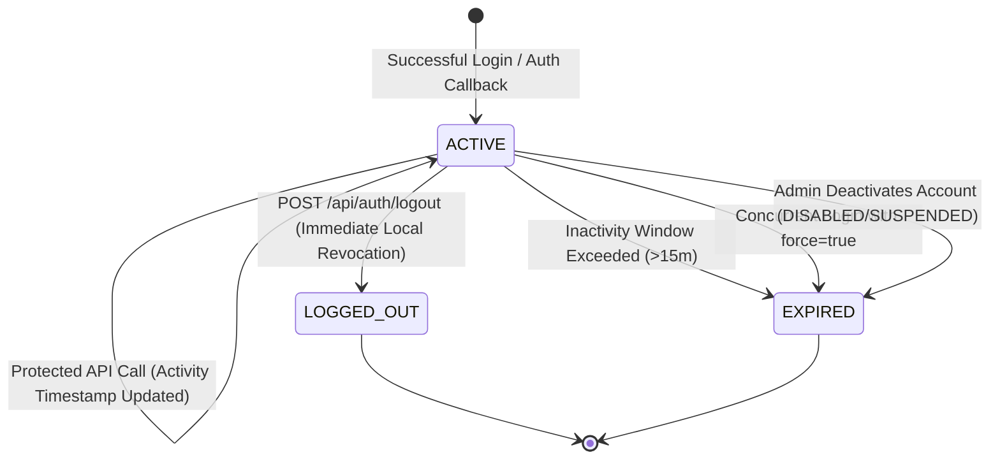

# Unified Session, Expiry and Logout Lifecycle Architecture (VYR-017)

## 1. Overview & Objectives

In accordance with **Epic 2 (Configurable authentication providers: Entra ID and Local Users)** and **Story VYR-017**, VEYRA provides a unified session lifecycle across all supported authentication providers (`LOCAL` and `ENTRA`).

Regardless of whether an identity is authenticated through Microsoft Entra ID (OIDC + PKCE) or local bcrypt database credentials:
1. All sessions share identical storage, expiry, sliding window, and revocation semantics.
2. Local logout enforces instant revocation across memory and database layers (`veyra_session`).
3. Disabled, suspended, or deprovisioned user accounts fail closed immediately on the next request with HTTP 403 `USER_DISABLED`.
4. Upstream Microsoft Entra Single Logout (SLO) is decoupled from local session termination so local security invariants are guaranteed independently.

---

## 2. Unified Principal Normalization & Session Schema

When an authentication provider completes user verification, `completeDatabaseLogin` normalizes the principal into an authoritative session structure:

```typescript
interface Session {
  token: string;                     // Cryptographic session token
  userId: string;                    // PostgreSQL UUID from veyra_user.id
  email: string;                     // RFC-normalized lowercase email
  displayName: string;               // Normalized display name
  role: string;                      // Primary RBAC role (SITE_ADMIN, AUDIT_MANAGER, etc.)
  permissions: string[];             // Explicit derived permissions
  isAdmin: boolean;                  // Site administrator flag
  createdAt: number;                 // Epoch milliseconds
  lastActivityAt: number;            // Epoch milliseconds of latest interaction
  expiresAt: number;                 // Epoch milliseconds of sliding expiration window
  status: 'ACTIVE' | 'LOGGED_OUT' | 'EXPIRED';
  authProvider: 'LOCAL' | 'ENTRA';   // Originating authentication provider
}
```

### PostgreSQL Persistence (`veyra_session` Table)
Sessions are persisted to PostgreSQL with strict constraints:
- `session_id`: Primary session identifier token.
- `user_id`: Foreign key reference to `veyra_user.id`.
- `status`: `ACTIVE`, `LOGGED_OUT`, `EXPIRED`, `REVOKED`.
- `partial unique constraint` (`uq_veyra_session_user_active`): Guarantees that at most one `ACTIVE` session exists per user at any point in time.

---

## 3. Session Lifecycle State Machine



### Key Invariants
- **Single Active Session**: Attempting a new login when an active session exists returns HTTP 409 `ACTIVE_SESSION_EXISTS`. The client must supply `{ force: true }` to revoke prior sessions and proceed.
- **Immediate Eviction**: When a session is logged out or expired, it is removed from the in-memory cache and its database row is transitioned to `LOGGED_OUT` or `EXPIRED`.
- **Fail-Closed Subsequent Access**: Any subsequent request presenting a revoked token immediately fails with HTTP 401 `INVALID_TOKEN`.

---

## 4. Real-time Account State Enforcement

To prevent security windows where deactivated or deprovisioned employees continue accessing sensitive audit data:
1. Every authenticated request processed by `requireAuth` calls `authService.validateSession(token, true)`.
2. `validateSession` inspects `veyra_user.status`:
   - If `status !== 'ACTIVE'` (e.g. `DISABLED`, `SUSPENDED`, or deprovisioned), the session is terminated immediately.
   - An audit trail entry `ACCOUNT_DEACTIVATED` is recorded.
   - The backend responds with HTTP 403 Forbidden:
     ```json
     {
       "success": false,
       "code": "USER_DISABLED",
       "status": "DISABLED",
       "message": "Your account is inactive or disabled. Please contact your system administrator."
     }
     ```
3. Frontend event listeners intercept HTTP 403 with code `USER_DISABLED`, instantly purge local storage, cache, and React session state, and navigate the user to the login screen with a descriptive alert banner.

---

## 5. Logout & Upstream Single Sign-Out (SLO)

### `POST /api/auth/logout` Response Schema
When a user clicks "Sign Out" or triggers a logout action:
```json
{
  "success": true,
  "message": "Logged out successfully.",
  "localLogout": true,
  "sessionInvalidated": true,
  "authProvider": "LOCAL",
  "upstreamSignoutSupported": false,
  "upstreamLogoutUrl": null
}
```

When running in Microsoft Entra mode (`AUTH_PROVIDER=ENTRA`):
```json
{
  "success": true,
  "message": "Logged out successfully.",
  "localLogout": true,
  "sessionInvalidated": true,
  "authProvider": "ENTRA",
  "upstreamSignoutSupported": true,
  "upstreamLogoutUrl": "https://login.microsoftonline.com/{tenantId}/oauth2/v2.0/logout?post_logout_redirect_uri=https%3A%2F%2Fapp.veyra.internal%2Flogin"
}
```

### Decoupled Upstream Redirection
Local session termination always takes immediate priority. If the user authenticated via Microsoft Entra, the frontend or client application can optionally redirect the browser to `upstreamLogoutUrl` to terminate the Microsoft SSO cookies, returning cleanly to VEYRA's login page via `post_logout_redirect_uri`.

---

## 6. Frontend Verification Walkthrough

To verify Story 17 in the user interface:

1. **Local User Sign Out**:
   - Sign in as `audit.manager@claaps.com` / `Manager@123` (or `admin@admin.com` / `Admin@123`).
   - Click the user profile pill in the top-right header.
   - Click **Sign Out / Logout**.
   - Verify immediate transition to the Sign-In page.
   - Attempting browser back navigation cannot access protected pages (token is purged from memory and storage).

2. **Session Inactivity Modal**:
   - Inactive user sessions trigger a 60-second warning countdown before expiration.
   - Clicking **Stay Logged In** calls `POST /api/auth/refresh` to extend session activity.
   - Clicking **Log Out Now** immediately invalidates the session and displays the expiration banner on the login screen.

3. **Real-time Deactivation Enforcement**:
   - Open VEYRA in two windows (or tabs). In Tab 1, sign in as Site Administrator (`admin@admin.com`).
   - In Tab 2, sign in as an Audit User.
   - In Tab 1 (User Management), change the Audit User's status from **Active** to **Disabled**.
   - In Tab 2, click any navigation item or report.
   - Verify Tab 2 is immediately locked out and redirected to the login page with the banner: *"Your account has been deactivated or disabled. Please contact your system administrator."*

