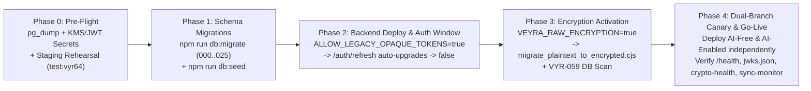

# VYR-064: Staged Rollout, Database Migration & Rollback Runbook

- **Story ID:** `VYR-064` (`EPIC 7 — Security, branch, regression and release testing`)
- **Branches Covered:** Both `standard-veyra-application-dev` (AI-Free) and `veyra-application-dev` (AI-Enabled)
- **Automated Non-Production Rehearsal:** `backend/scripts/test_story_064_release_rollback_rehearsal.cjs` (`npm --prefix backend run test:vyr64`)

---

## 1. Release Readiness & Pre-Flight Gates

All gates below must pass before promoting any release artifact from Staging to Production:

1. **Dual-Branch Clean Build Validation (`VYR-062`):**
   - Run `npm --prefix backend run test:vyr62` (or `node backend/scripts/test_story_062_builds_and_artifacts.cjs --clean-build`) on both `standard-veyra-application-dev` and `veyra-application-dev`.
   - Confirm `POST /api/chat` returns `404` and zero AI dependencies exist in the AI-Free branch, and AskVeyra retains `requireAskVeyra` protection on the AI-Enabled branch.
2. **Core Regression & Security Assessment (`VYR-061`, `VYR-063`):**
   - Run `npm --prefix backend run test:vyr61` (`158 / 158`) and `npm --prefix backend run test:vyr63` (`53 / 53`).
   - Confirm **0 unresolved critical findings** and **0 unresolved high findings without documented risk acceptance** ([VYR-063_SECURITY_ASSESSMENT_AND_REMEDIATION_REPORT.md](VYR-063_SECURITY_ASSESSMENT_AND_REMEDIATION_REPORT.md)).
3. **Production Configuration Gate (`VYR-055`):**
   - Verify `STRICT_CONFIG_VALIDATION=true` (or `NODE_ENV=production` strict check) passes `validateStartupConfig({ strict: true })` with zero fallback keys (`ORACLE_ENCRYPTION_KEY`, `DATABASE_URL`, explicit `JWT_PRIVATE_KEY` / `JWT_PRIVATE_KEY_PATH`, non-loopback HTTPS `ORACLE_FUSION_BASE_URL`, and `ENTRA_*` if `AUTH_PROVIDER=ENTRA`).
4. **Full Off-Line Database Backup:**
   - Capture snapshot prior to schema or plaintext encryption migration:
     ```bash
     pg_dump "$DATABASE_URL" -Fc -f pre_release_backup_$(date +%Y%m%d_%H%M%S).dump
     ```
   - Store encrypted backup off-host with restricted IAM access until post-release verification completes.

---

## 2. Staged Rollout & Database Migration Sequencing



### Phase 0 — Provision Target Secrets & Config
1. Configure runtime secret manager / environment per [VYR-055_secrets_management_and_rotation_runbook.md](VYR-055_secrets_management_and_rotation_runbook.md):
   - `KMS_PROVIDER` (`AWS_KMS` / `AZURE_KEY_VAULT` / `LOCAL_VAULT`), `VEYRA_KMS_KEY_ID`, `VEYRA_KEY_RING` (if multi-key), `ORACLE_ENCRYPTION_KEY` (32+ chars, never the default seed).
   - `JWT_KEY_ID`, `JWT_PRIVATE_KEY` / `JWT_PRIVATE_KEY_PATH`, `JWT_PUBLIC_KEY` (plus `JWT_PREVIOUS_KEY_ID` / `JWT_PREVIOUS_PUBLIC_KEY` if rolling existing RS256 keys).
   - `AUTH_PROVIDER=LOCAL` or `AUTH_PROVIDER=ENTRA` with `ENTRA_TENANT_ID`, `ENTRA_CLIENT_ID`, `ENTRA_REDIRECT_URI`, and `ENTRA_CLIENT_SECRET` (or `AZURE_FEDERATED_TOKEN_FILE`).
   - `ALLOWED_ORIGINS` set to explicit HTTPS frontend origins.
2. Execute non-production rehearsal:
   ```bash
   npm --prefix backend run build
   npm --prefix backend run test:vyr64
   ```

### Phase 1 — Ordered PostgreSQL Schema Migrations (`database/migrations/`)
Migrations run via `node-pg-migrate` (`npm --prefix database run migrate` or `npm run db:migrate`; also invoked by container `CMD ["npm", "run", "start:migrate"]`):

| Step | Migration Range / Key Files | Tables & Columns Added | Safe With N-1 Code? |
| :---: | :--- | :--- | :---: |
| 1A | `1711000000000`–`1711000000017` | Baseline RBAC, `veyra_session`, `veyra_audit_event`, dashboards, reports, Oracle raw tables, incident rows, cert vectors | Yes |
| 1B | `1711000000018_create_veyra_user_identity_mapping_table.cjs` | `veyra_user_identity_mapping` (`ENTRA`/`LOCAL`/`SAML` OID bindings) | Yes |
| 1C | `1711000000019`–`1711000000020` | `oracle_raw_user_access`, `oracle_incident_rows` | Yes |
| 1D | `1711000000021_create_oracle_raw_encrypted_payloads_and_columns.cjs` | Adds `is_encrypted` (default `false`), `encryption_format_version`, `encryption_key_id`, `encrypted_at` + indexes across all 10 raw tables + creates `oracle_encryption_migration_ledger` | Yes (additive columns) |
| 1E | `1711000000022_create_veyra_distributed_locks_table.cjs` | `veyra_distributed_locks` | Yes |
| 1F | `1711000000023_create_veyra_sync_checkpoints_and_quarantine_tables.cjs` | `veyra_sync_checkpoints`, `veyra_sync_quarantine` | Yes |
| 1G | `1711000000024_create_veyra_rate_limit_and_lockouts_tables.cjs` | `veyra_account_lockouts`, `veyra_rate_limit_events` | Yes |
| 1H | `1711000000025_vyr053_audit_event_security_columns.cjs` | Widens `ck_veyra_audit_event_type`; adds `correlation_id`, `service_identity`, `tenant`, `result`, `event_hash` | Yes |
| 1I | `npm run db:seed` & admin provisioning | Seeds RBAC roles/privileges & admin user | Yes |

Verify schema state before deploying application pods:
```bash
npm --prefix backend run test:vyr31
```

### Phase 2 — Auth Token Migration Window & Backend Rollout
1. **Deploy with Temporary Compatibility Window (if active opaque sessions must survive rollout):**
   - Set `ALLOW_LEGACY_OPAQUE_TOKENS=true` for a bounded transition window (recommended <= 1 hour, matching the 15-minute session inactivity timeout).
   - Deploy `backend` + `frontend`. Existing opaque sessions continue authenticating and automatically upgrade to signed `RS256` JWTs on their next `POST /api/auth/refresh`.
2. **Close Compatibility Window:**
   - Remove `ALLOW_LEGACY_OPAQUE_TOKENS` or set `ALLOW_LEGACY_OPAQUE_TOKENS=false` and perform a rolling restart.
   - All `/api/*` requests now strictly require valid `RS256` `typ: at+jwt` tokens with zero PII claims and active `veyra_session` state.

### Phase 3 — Encrypted Writes & In-Place Plaintext Data Migration
1. Set `VEYRA_RAW_ENCRYPTION=true` across all web/sync replicas so every new Oracle ingestion writes `AES-256-GCM` encrypted containers through `encryptedRecordWriter`.
2. Verify schema readiness and preview candidate plaintext counts (read-only):
   ```bash
   node backend/scripts/migrate_plaintext_to_encrypted.cjs --host <tenant-host> --dry-run
   ```
3. Execute restartable, checksum-guarded encryption migration across all 10 raw tables (run per tenant):
   ```bash
   node backend/scripts/migrate_plaintext_to_encrypted.cjs --host <tenant-host> --batch-size 200
   ```
   - Inspect `oracle_encryption_migration_ledger` until every table has `status = 'COMPLETED'` and `plaintext_records = 0` (excluding NULL payloads).
4. Prove zero sensitive plaintext leakage in PostgreSQL:
   ```bash
   npm --prefix backend run test:vyr59
   ```

### Phase 4 — Independent Branch Promotion & Canary Smoke Check
Deploy each variant independently from its protected release tag/branch (`Dockerfile` + `railway.json` on Railway, or OCI container registry):
1. **`standard-veyra-application-dev` (AI-Free):**
   - Confirm `GET /health` -> `200`, `GET /api/.well-known/jwks.json` -> `200`, `POST /api/chat` -> `404`.
2. **`veyra-application-dev` (AI-Enabled):**
   - Confirm `GET /health` -> `200`, `POST /api/chat` with `AUDIT_MANAGER` -> `200`, with `AUDIT_SUPERVISOR` -> `403`.
3. **Post-Deploy Health Sweep (Both Branches):**
   - Call `GET /api/security/crypto-health` (`status !== 'CRITICAL'`), `GET /api/security/sync-monitor` (`status !== 'CRITICAL'`), and `GET /api/admin/security/secrets-status` (`validationReport.valid === true`).

---

## 3. Rollback Procedures

| Scenario | Trigger | Max SLA | Owner |
| :--- | :--- | :---: | :--- |
| **RB-1: Auth Token Migration Rollback** | Elevated `401 INVALID_TOKEN` / lockouts after closing opaque token window, or Entra/JWKS signing regression | 10 min | Auth / Platform Owner |
| **RB-2: Encryption Schema Rollback** | Schema incompatibility discovered before plaintext backfill or requiring clean schema revert | 20 min | DBA & Engineering Lead |
| **RB-3: Plaintext Data Migration Rollback** | Downstream compatibility fault or corrupt KEK/data detected during/after `VYR-037` backfill | 20 min | Engineering Lead & DBA |
| **RB-4: Branch Deployment Rollback** | Regression or healthcheck failure (`/health` non-200) on `standard-veyra-application-dev` or `veyra-application-dev` | 5 min | Release Manager / DevOps |

### 3.1 RB-1 — Auth Token Migration Rollback
1. **Option A — Re-open Compatibility Window (Fastest, zero user impact for active sessions):**
   - Set `ALLOW_LEGACY_OPAQUE_TOKENS=true` and restart/redeploy backend. Active `veyra_session` rows resume validating opaque tokens until window expiry.
2. **Option B — JWKS Key Rollback (if rotating RSA signing key):**
   - Restore prior `JWT_PRIVATE_KEY` / `JWT_KEY_ID` and keep retiring public key in `JWT_PREVIOUS_KEY_ID` / `JWT_PREVIOUS_PUBLIC_KEY` so in-flight tokens from both keys stay verifiable during the rollout.
3. **Option C — Full Session Reset (Emergency Security Fail-Safe):**
   - Revert container image to N-1 release, purge active sessions via `POST /api/admin/sessions/cleanup` or CLI `npm --prefix backend run clear-sessions`, forcing clean re-authentication.
4. **Verify:** `GET /api/.well-known/jwks.json` returns `200` with expected `kid`(s); `POST /api/auth/login` + `GET /api/auth/status` succeed.

### 3.2 RB-2 — Encryption Schema Rollback (`node-pg-migrate down`)
> [!WARNING]
> Never drop migration `1711000000021` while rows in raw tables still hold `is_encrypted = true` ciphertexts — execute **RB-3** first so rows are restored to readable JSON before dropping tracking columns, or keep `021` intact and roll back application code only (dual-mode columns are dormant to N-1 code).

1. Complete **RB-3** (decrypt-to-plaintext or `pg_restore`) if downgrading below `1711000000021`.
2. Step down recent migrations cleanly in reverse chronological order:
   ```bash
   # Example: revert VYR-053 audit columns (025), rate limits (024), checkpoints (023), locks (022), encryption cols (021)
   npm --prefix database run migrate:down -- 5
   ```
3. Verify schema state matches target release tag (`psql "$DATABASE_URL" -c "SELECT name FROM pgmigrations ORDER BY id DESC LIMIT 10;"`).

### 3.3 RB-3 — Plaintext-to-Encrypted Data Migration Rollback
1. **Freeze Encrypted Writes:** Set `VEYRA_RAW_ENCRYPTION=false` and restart workers/web nodes (`rollbackTable` refuses to run while encryption is active).
2. **Preserve Decryption KEKs:** Ensure all `ACTIVE`, `RETIRING`, and `COMPROMISED` keys used by stored rows remain mounted in `VEYRA_KEY_RING` / KMS.
3. **Execute Audited Decrypt-Back Rollback (Per Raw Table & Tenant):**
   ```bash
   node backend/scripts/migrate_plaintext_to_encrypted.cjs \
     --host <tenant-host> \
     --table <raw_table> \
     --rollback \
     --confirm DECRYPT_TO_PLAINTEXT
   ```
   - Inspect `oracle_encryption_migration_ledger` (`status = 'ROLLED_BACK'`, `failed = 0`).
4. **Full Database Dump Recovery (if storage corruption occurred):**
   ```bash
   pg_restore "$DATABASE_URL" --data-only --clean --if-exists -t 'oracle_raw_*' -t oracle_control_incidents -t oracle_incident_rows pre_release_backup_<timestamp>.dump
   ```

### 3.4 RB-4 — Independent Branch Deployment Rollback
Each branch deploys as a self-contained artifact (`standard-veyra-application-dev` and `veyra-application-dev` never share runtime dependencies):
1. Roll back the affected branch service in Railway (Deployments -> **Rollback** to last green deployment) or redeploy the pinned prior Git tag / container digest:
   ```bash
   git checkout <last-known-good-tag>
   npm --prefix backend run build && npm --prefix frontend run build
   ```
2. Leave schema migrations forward when additive (`021`–`025`), or execute **RB-2** / **RB-3** only if the previous release cannot tolerate new data formats.
3. Verify branch identity post-rollback (`POST /api/chat` -> `404` on AI-Free vs `200`/`403` on AI-Enabled) and `GET /health` -> `200`.
